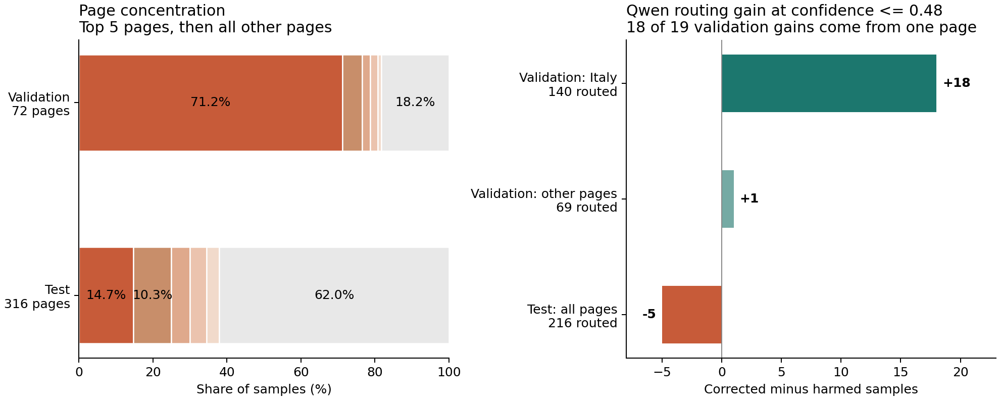

# VitaminC / JEV 实验审计

审计日期：2026-11-09。基于本地数据、SQLite 检查点及保存的配置离线复算，没有调用模型 API，没有修改原始数据和实验结果。

**核心发现：验证集存在严重的页面集中问题，Qwen 的验证收益几乎全部来自一个页面；threshold 图与最终单模型排名又不是同一个比较口径。当前证据没有显示评分实现错误，也不能据此要求最终结果必须符合最初预期。**

## 1. 仓库实际在做什么

流程为：官方 VitaminC dev/test → 过滤 real、清理冲突/重复、分组切分 → 50 条 pilot → 验证集选置信度阈值 → 固定阈值在 test 上比较单模型和级联。

| 文件/目录 | 实际用途 |
|---|---|
| `data/vitaminc/` | 原始 train/dev/test；本地实验没有训练或微调模型 |
| `data/split_vitaminc.py` | 只使用官方 dev/test 的 real 样本，按 page/case/文本对/ID 建连通分组并隔离子集 |
| `data/vitaminc_splits/` | prompt_dev 200、calibration 2000、threshold_validation 2000、当前 test 2000 |
| `code/run_pilot.py` | 共用模型配置、请求及解析；pilot 采样为 S/C/I = 15/15/20 |
| `code/run_threshold.py` | JEV 跑 2000 条；每个 LLM 只跑最低置信度、预算允许的 396 条；选阈值 |
| `code/run_final_eval.py` | JEV 和三个 LLM 各跑完整 2000 条，并由同一批预测重建级联 |
| `code/test_api_*_single.py`、`code/test_jev.py` | 单条接口连通性测试；不是最终实验的请求实现 |

这里评测的是给定 claim/evidence 后的 S/C/I 分类，不包含检索、生成等完整 RAG 流程。README 中的 “flagging 数据”称呼需要核正：当前字段和任务对应 fact verification；官方将 revision flagging 与 fact verification 分开列出。[VitaminC 官方说明](https://github.com/TalSchuster/VitaminC#fact-verification)

## 2. 先检查数据集

### 2.1 完整性检查通过，但旧划分报告已过期

- 官方 dev/test 文件 SHA256 与保存的 split_report 一致。
- 四个当前实验子集中，ID 重复、标准化 claim/evidence 对重复、标签映射错误均为 0。
- 四个子集两两之间的 page、case、文本对、ID 交集均为 0；这是精确/空白归一化检查，不是语义去重。
- 当前每条样本的原始字段均与本地官方来源一致；没有发现本地切分改坏 claim、evidence 或 label。
- 用原 seed 在内存重跑原切分，prompt_dev、calibration、threshold_validation 完全复现。
- 当前 test 2000 条全部属于重建的原 test 5000 条，但不是简单的前 2000 条。目录中没有记录这一步缩减的脚本/seed，split_report 仍写 5000。可以验证来源，不能完整复现缩减过程。
- 当前 validation/test 文件哈希与各自模型结果检查点一致，未发现“当前数据与当时评分数据不一致”。

另查了官方 train：没有与当前实验集共享的 ID、case 或完整文本对；有 28 条 train 行与 calibration 同页面、36 条 train 行与 test 同页面。本地实验没有使用 train，此检查不能说明任何 API 模型的训练数据或污染情况。

### 2.2 最重要的问题：标签分层没有保证页面分布

| 数据集 | 样本数 | S / C / I | 页面数 | case 数 | 最大页面及占比 |
|---|---:|---|---:|---:|---|
| prompt_dev | 200 | 100 / 57 / 43 | 25 | 74 | Excuse My French：9.5% |
| calibration | 2000 | 996 / 575 / 429 | 205 | 694 | Dirty Grandpa：12.8% |
| threshold_validation | 2000 | 996 / 575 / 429 | 72 | 653 | 意大利疫情：**1424 条，71.2%** |
| test | 2000 | 1002 / 575 / 423 | 316 | 1336 | 德国疫情：294 条，14.7% |

验证集和测试集的标签比例几乎一样，但主题和页面分布差异很大。意大利疫情在官方 dev-real 中仅有 1472 / 42290 ≈ 3.48%，在验证集中被放大到 71.2%。测试集也并非均匀或完整代表官方 test：德国疫情在官方 test-real 中约占 2.52%，在当前 test 中占 14.7%。

机制在 [`select()`](../../data/split_vitaminc.py#L117)：先打乱整个连通分组，再不断加入完整组直到三类样本足够，最后只按标签采样。这个实现保证了分组隔离和标签配额，却没有约束某个大页面占据绝大多数样本。

相同 claim 搭配不同 evidence 是这个任务的正常结构，不能当作重复样本直接全部删除；但它们也不是完全独立的观测。验证集 2000 条只有 1023 个不同 claim、761 个不同 evidence，因此统计不确定性需要考虑 case/page 分组。

### 2.3 页面偏差对结果的具体贡献

在固定 `confidence <= 0.48` 下，Qwen 的配对结果如下。“纠正/改错”均按数据集原标签计算。

| 样本范围 | 转交条数 | JEV 正确 | Qwen 正确 | 纠正 | 改错 | 净变化 |
|---|---:|---:|---:|---:|---:|---:|
| 验证集：意大利疫情 | 140 | 66 | 84 | 37 | 19 | **+18** |
| 验证集：其他页面 | 69 | 35 | 36 | 11 | 10 | **+1** |
| 验证集合计 | 209 | 101 | 120 | 48 | 29 | **+19** |
| 测试集合计 | 216 | 122 | 117 | 35 | 40 | **−5** |

验证集净增的 19 个正确答案中，18 个来自一个页面。这个页面不在测试集内。因此，验证收益缺少跨页面泛化的支撑。这是已经量化的主要问题；它不是对所有分数变化的单一因果证明。



### 2.4 原始标签也有值得人工复核的实例

这些疑点与原始文件一致，不是本地切分引入。以下为针对模型分歧的定向抽查，**不能据此估计整个数据集的错标率**。

| test unique_id | 证据与 claim 的关系 | 原 gold / JEV / Qwen | 需要复核的原因 |
|---|---|---|---|
| `5ed7ad00c9e77c00084a5f3a_1` | 证据说美国销量超过 1400 万，claim 说少于 1600 万 | S / S / I | 单独的下界无法推出这个上界；按当前“fully supports”提示词，I 有合理依据，但被评分为错 |
| `5ea2d97bc9e77c0009cda252_4` | 证据说 158 条影评中 66% 为正面，claim 说正面影评少于 67 条 | S / C / S | 66% 是比例，约对应 104 条，和“少于 67 条”有明显量纲/数量冲突；这次反而有利于 Qwen 的基准分数 |
| `5ee3932ac9e77c0008cc9bc1_3` | 证据是 4 月 13 日 1030 例，claim 是 4 月 13 日之后超过 1040 例 | I / I / C | 不同时间点的数字不构成直接矛盾，Qwen 在这里疑似忽略了时间限定 |

这表明需要分别讨论“与基准标签一致”及“是否严格由给定证据推出”。目前既有模型错误的例子，也有标签/任务标准有疑义的例子，不能把 JEV 的领先全部归因于其中一种。

## 3. 再检查实验设置

### 3.1 两阶段请求一致，评分复算一致

validation 和 test 检查点保存的 `request_configs`、请求地址完全相同：JEV `jev-1.14.0`，Qwen `qwen3.8-max`，DeepSeek `deepseek-v4.1-flash-1017`，Kimi `kimi-k3.1-pro`。三个 LLM 都是 `enable_thinking=false`、`max_completion_tokens=32`，使用同一 S/C/I 定义。

保存的返回 model 字段与请求一致；这只说明日志中的名称一致，不保证提供方未改变同名模型的后端实现。

最终每个模型有 2000 条有效结果，三个 LLM 都以 `stop` 结束，没有发现输出截断或解析失败解释分数落差。12 次连接失败均有后续成功终态，终态样本无重复。JSONL 导出与 SQLite attempts 一致。

独立逐条复算，最终 7 行结果的 accuracy、Macro-F1 均与 summary.csv 一致；threshold_sweep 的 40 个点（含不转交）也一致。没有发现 S/C/I 映射颠倒、按索引配错样本、缺失预测被偷偷删除或级联增减算反。

当前打开的 `test_api_kimi_single.py` 使用另一个简短提示词、`max_tokens=16`，且没有显式关闭 thinking；但正式实验从 `run_pilot.make_payload()` 构造请求，所以这个单条测试文件的设置不是本次分数变化的来源。

### 3.2 threshold 曲线的纵轴是级联准确率

验证阶段三个 LLM 各仅跑 396 条，没有任何一个 LLM 的“完整 2000 条独立准确率”。图中的 Qwen 曲线实际是 JEV + Qwen，只在满足阈值时替换 JEV 的预测。曲线图例只写模型名，容易让人误读。

| 方法 | validation：2000 条 | test：2000 条 |
|---|---:|---:|
| JEV only | 86.40% | 84.90% |
| Qwen only | **未测完整集** | 83.20% |
| JEV + Qwen，0.48 | 87.35%（+0.95 个百分点） | 84.65%（−0.25 个百分点） |
| JEV + DeepSeek，0.48 | 86.50%（+0.10 个百分点） | 84.05%（−0.85 个百分点） |
| JEV + Kimi，0.48 | 86.40%（无增益） | 83.60%（−1.30 个百分点） |

因此，threshold 实验从未证明“Qwen 单模型整体强于 JEV”。真正需要解释的是级联小幅增益未在 test 重现，这与上面的页面偏差和有限样本有关。

### 3.3 低置信度不等于 LLM 更有优势

设转交集合为 L，则级联相对 JEV 的准确率变化为：

`转交比例 × (LLM 在 L 上的准确率 − JEV 在 L 上的准确率)`

| 0.48 以下的样本 | validation | test |
|---|---:|---:|
| 转交数量/比例 | 209 / 10.45% | 216 / 10.80% |
| JEV 准确率 | 101/209 = 48.33% | 122/216 = 56.48% |
| Qwen 准确率 | 120/209 = 57.42% | 117/216 = 54.17% |
| DeepSeek 准确率 | 103/209 = 49.28% | 105/216 = 48.61% |
| Kimi 准确率 | 101/209 = 48.33% | 96/216 = 44.44% |

JEV 的 confidence 能定位相对困难的样本，但这些样本对 LLM 也困难。想提升准确率，路由需要识别“LLM 相对 JEV 的优势”，而不只是“JEV 容易错”。

再按 gold 拆分，Qwen 转交的净变化在 validation 为 S:+1、C:+20、I:−2；test 为 S:−11、C:+8、I:−2。整体三类比例近似不变，并不意味着每类内的难度和模型差距不变。

test 单模型差距也可直接分解：JEV 在 S 类多对 52 条，C 类少对 23 条，I 类多对 5 条，合计多对 34 条，即 1.70 个百分点。Qwen 在 C 类仍然更强，不能把总分排名理解为每类都更差。

### 3.4 设计上还需要修正的几处

1. **calibration 数据被预留，却未实际使用。** 三个实验脚本中没有拟合或应用校准器；阈值文件明确写着 raw Jev confidence。保存的 JEV 响应中，confidence 与 `1.5 × max(probabilities) − 0.5` 的最大差异约为 0.005，符合显示精度范围内的线性关系。这是日志观察，不是提供方算法证明，更不能把 confidence 当作实测正确率。即使做单调校准，也不会自动改善样本排序或 LLM 的相对优势。
2. **0.48 优化的是三条级联准确率的平均值。** 它不是 Qwen 专用最优阈值。Qwen 在 validation 的最佳点为 0.49/0.50、87.40%；相比 0.48 只多对 1 条。这个差别很小，无法解释主问题。
3. **同一验证集同时选阈值、展示最优收益。** 搜索了 40 个点，存在选择乐观偏差，且页面高度相关。应该用多个按 page 分组的验证折评估稳定性，固定策略后再测独立测试集。
4. **最终阈值写死在 `run_final_eval.py:19`。** 当前 0.48 与选择文件一致，所以没有导致这次错误；后续应读取并验证选阈值产物及其配置哈希，避免失配。
5. **只测了一套非思考、零样本提示配置。** 未显式指定 temperature/top_p/seed，也未重复推理。当前结果只能代表这套请求配置，不能归纳模型总体能力。没有证据表明这些默认参数在两阶段发生变化，因此不能把它们说成已确认原因。
6. **pilot 与正式评估分布不同。** pilot 仅 50 条，I 占 40%，正式集约 21%，且 pilot 用排序后的最低 20%（10 条），不是统一的 0.48（该 pilot 下为 8 条）。pilot 的 JEV 62%、Qwen 70% 适合用于接口/成本筛查，不能直接与后续 2000 条排名比较。

## 4. 分数差异有多确定

对 test 做 10000 次配对分组 bootstrap，seed=20261109。每次整体重采样 page 或 case，保留同一组内模型预测的配对关系。下表均为“候选方法 − JEV”的准确率差，单位是百分点。

| 比较 | 点估计 | 按 page 的 95% 区间 | 按 case 的 95% 区间 |
|---|---:|---:|---:|
| Qwen only − JEV | −1.70 | [−2.90, −0.44] | [−2.99, −0.40] |
| JEV + Qwen − JEV | −0.25 | [−1.16, +0.57] | [−1.11, +0.60] |

在当前样本和原标签下，JEV 相对 Qwen 单模型的优势有较明确支持；级联与 JEV 的 −0.25 个百分点差异仍包含零，不能宣布级联稳定有害。这些区间以当前抽样为条件，不纠正标签噪声、数据域偏移、阈值选择或模型推理随机性。也没有评估 DeepSeek 与 Kimi 之间仅 3 条正确答案差距的显著性，不应把那个名次外推为稳定能力排序。

## 5. 建议的下一步，按优先级

1. 保留这次结果作为已完成的基准记录，记录 2000 条 test 的固定 ID、hash 和缩减方式。既然已经看过 test，不再用它反复选阈值后宣称独立验证。
2. 优先修正数据抽样：继续隔离 page/case，同时约束页面集中度，并报告与目标数据分布的差异；用多个按 page 划分的验证折或多个预先固定的 seed 检查增益。如果采用每页面上限，要注明评估对象变为更均衡的页面分布，不能与原指标不加区分地合并。
3. 对导出的模型分歧做盲审，外加分层随机样本；单独记录标签疑点和证据缺失问题。不要只挑某模型失败的例子，也不要为了改变排名而修改 test gold。
4. 用现有验证预测先做免费离线稳定性分析；如需新请求，优先覆盖更分散页面的困难样本。按最终部署的目标模型选择策略，评估正确→错误与错误→正确两种转移，不预设 LLM 必须更强。
5. 后续实验固定提示词、推理模式和采样参数；将所选阈值及模型配置作为明确输入。更复杂的路由若要学习相对优势，需要同时有 JEV/LLM 标签结果的独立训练/验证数据，不能直接在已查看的 test 上拟合。
6. 成本结论先限定为 LLM 调用量/费用：test 的级联确实减少了 89.2% 的 LLM 调用，但 JEV 单价未填，总费用是否更低尚不能确认。延迟是保存的终态请求耗时之和，未包括失败重试、排队和编排，不等于生产系统完整端到端观测。

本次适合保留的结论是：**在当前 VitaminC-real 子集与固定请求配置下，JEV 单模型优于三个 LLM；Qwen 在高度集中的验证集上提供了小幅级联增益，但该增益没有在 test 中重现。优先处理页面采样和验证稳定性，再判断是否值得增加路由复杂度。**

## 6. 可复现审计产物

- [审计脚本](../audit_experiments.py)：仅依赖标准库；绘图额外依赖 matplotlib。
- [完整检查与统计 JSON](audit.json)：数据完整性、分布、模型/标签分组、混淆矩阵、bootstrap。
- [分组统计 CSV](subgroups.csv)：按页面、置信度区间和阶段比较纠正/改错。
- [Qwen 低置信度分歧样本](qwen_routed_disagreements.jsonl)：包含原始 claim/evidence、标签和预测，便于人工复核。pilot 行使用统一的 0.48，仅作诊断，不等于原 pilot 的最低 20%。
- [概览图](audit_overview.png)。

在仓库目录运行：

```bash
python code/audit_experiments.py --plot
```

默认输出到 `code/audit_results/`，不会重跑 API 或修改原数据、原实验脚本和原结果。这里的文字分析报告不会被该命令重写。
