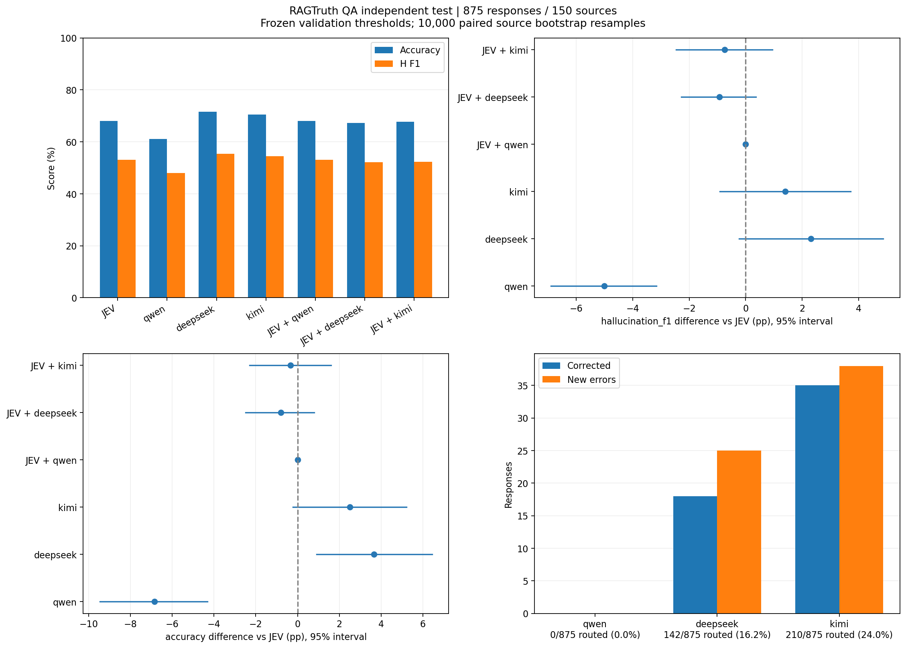
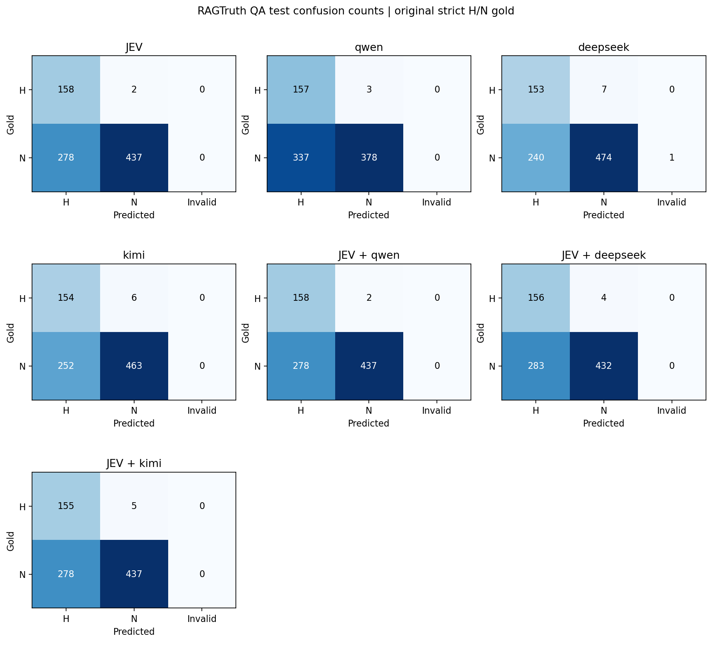

# RAGTruth QA 独立测试

正式 validation/test 已完成 **8,128 个终态结果**；另记录验证阶段 0 次、测试阶段 50 次非终态尝试。pilot 的 192 次请求未重复运行。收集并发与重试设置见各目录的 `collection_runs.json`，失败类型和无效终态见 `attempt_summary.json`。

[冻结协议](../../code/ragtruth_protocol.json) · [pilot 案例审阅](../../docs/ragtruth_pilot_review.md)。两阶段数据、配置与固定阈值通过哈希关联；代码可从逐条本地检查点独立复算结果。

独立 test：150 个问题、875 段回答（H=160、N=715），四模型共 3,500 个终态结果。使用完整 validation 固定的阈值，未按测试集重新选择。H 是幻觉阳性类；下列区间来自 10,000 次按 source_id 配对 bootstrap，单位为百分点。

| 方法 | Accuracy | Macro-F1 | H Precision | H Recall | H F1 | H F1 相对 JEV 差值 [95% 区间] |
|---|---:|---:|---:|---:|---:|---|
| jev_only | 68.00% | 64.38% | 36.24% | 98.75% | 53.02% | +0.00 [+0.00, +0.00] |
| llm_only/qwen | 61.14% | 58.50% | 31.78% | 98.12% | 48.01% | -5.01 [-6.89, -3.17] |
| llm_only/deepseek | 71.66% | 67.30% | 38.93% | 95.62% | 55.33% | +2.31 [-0.23, +4.88] |
| llm_only/kimi | 70.51% | 66.31% | 37.93% | 96.25% | 54.42% | +1.40 [-0.91, +3.71] |
| cascade/qwen | 68.00% | 64.38% | 36.24% | 98.75% | 53.02% | +0.00 [+0.00, +0.00] |
| cascade/deepseek | 67.20% | 63.58% | 35.54% | 97.50% | 52.09% | -0.93 [-2.27, +0.36] |
| cascade/kimi | 67.66% | 63.91% | 35.80% | 96.88% | 52.28% | -0.74 [-2.47, +0.94] |

全部预测 N 的 test accuracy 为 81.71%，H F1 为 0；因此不能仅凭 accuracy 评价幻觉检出效果。验证与测试的 H 比例不同，分数变化不能直接解释为方法变化。

单模型无效输出：jev_only：0 条；llm_only/qwen：0 条；llm_only/deepseek：1 条；llm_only/kimi：0 条。无效输出保留在评分分母中。

| 级联 | test 转交 | 纠正 / 改错 | 无效 LLM 回退 | Accuracy 相对 JEV 差值 [95% 区间] |
|---|---:|---:|---:|---|
| JEV + qwen | 0/875（0.00%） | 0 / 0 | 0 | +0.00 [+0.00, +0.00] |
| JEV + deepseek | 142/875（16.23%） | 18 / 25 | 1 | -0.80 [-2.48, +0.80] |
| JEV + kimi | 210/875（24.00%） | 35 / 38 | 0 | -0.34 [-2.30, +1.61] |

**这张图怎么看（RAGTruth 独立 test，875 段回答）：**

| 位置 | 横轴 | 纵轴、点与线的含义 | 读图重点 |
|---|---|---|---|
| 左上 | 七种方案，JEV、三个 LLM only 和三个级联 | 分数（%）；蓝柱是 accuracy，橙柱是 H F1 | 同色柱子之间比较，越高越好。高 accuracy 不一定代表能找出幻觉，所以同时看 H F1 |
| 右上 | H F1 相对 JEV 的差值（百分点） | 六种对比方案；圆点是本次差值，横线是 95% bootstrap 区间 | 竖虚线 0 表示与 JEV 一样；右侧为提高，左侧为降低；区间跨 0 时，本轮不足以确定稳定差异 |
| 左下 | accuracy 相对 JEV 的差值（百分点） | 与右上相同的六种方案、圆点和区间 | 比较的是准确率，不要把这里的区间当作 H F1 区间。横线是重采样区间，不是拟合线 |
| 右下 | 三个级联；标签同时列出实际转交条数和比例 | 发生变化的回答条数；蓝柱是纠正，橙柱是改错 | 蓝柱比橙柱高才是多答对题。两柱相加不一定等于转交总数，因为很多回答转交前后都对或都错 |

Qwen 级联的点与区间都落在 0，是因为验证阶段已经选中完全不转交，实际预测逐条等于 JEV；不是额外测试证明了两个不同模型等价。测试只应用固定策略，不在这张图上反过来挑新阈值。

**这张混淆矩阵怎么看：** 七个小图分别对应七种方案，最后两个空位只是排版预留，不表示漏跑模型。每个小图的**横轴是模型预测**：H（有幻觉）、N（无幻觉）、Invalid（无效输出）；**纵轴是原数据标签**：H 或 N。每个格子的数字是回答条数，不是百分比。

| 格子位置 | 含义 |
|---|---|
| H 行、H 列 | 正确找出的幻觉 |
| H 行、N 列 | 有幻觉却没发现，即漏报 |
| N 行、H 列 | 原标注没有幻觉却被报为有，即误报 |
| N 行、N 列 | 正确判断为没有幻觉 |
| 任一行、Invalid 列 | 没有给出合法 H/N，单模型评分计错；级联按规则回退 JEV |

每幅图所有格子相加为 875；H 行合计 160，N 行合计 715。颜色越深表示该小图中数量越多，但不同小图分别缩放颜色，因此跨模型比较时要读数字，不能只比较深浅。理想情况是 H/H 与 N/N 格子大，误报、漏报和 Invalid 格子小。

[混淆矩阵图](../../code/ragtruth_final_results/confusion_matrices.png) · [完整指标、调用与成本](../../code/ragtruth_final_results/summary.csv) · [bootstrap](../../code/ragtruth_final_results/bootstrap.json) · [按原回答生成模型分组](../../code/ragtruth_final_results/by_generator.csv) · [排除 implicit_true 的敏感性评分](../../code/ragtruth_final_results/sensitivity_without_implicit_true.csv)

**如果不把 implicit_true 算作幻觉，结果会怎样？** 这项检查保留同一批预测和固定阈值，只改变评分标签：某段回答如果只有“材料没写、但可能真实”的片段，就从 H 改按 N 评分。test 的 H 从 160 段变为 134 段，回答总数仍为 875。

| 方案 | 主口径 H F1 | 排除 implicit_true 后的 H F1 |
|---|---:|---:|
| jev_only | 53.02% | 46.32% |
| llm_only/qwen | 48.01% | 41.72% |
| llm_only/deepseek | 55.33% | 48.20% |
| llm_only/kimi | 54.42% | 47.78% |
| cascade/qwen | 53.02% | 46.32% |
| cascade/deepseek | 52.09% | 45.38% |
| cascade/kimi | 52.28% | 45.50% |

这些分数评的是不同标签定义，不能把下降说成模型突然变差。本轮排除 implicit_true 后，过多报 H 的问题仍在；这不是重新训练或重新写提示词后得到的效果。

**本轮结论：**

- JEV + qwen：验证阶段选择不转交，实际策略与 JEV only 完全相同，差值及区间为零。
- JEV + deepseek：区间包含零，尚不能判定 H F1 稳定改善或下降。
- JEV + kimi：区间包含零，尚不能判定 H F1 稳定改善或下降。

**本轮未观察到固定阈值级联提高测试集 H 类 F1。** 单模型整体表现较好，也不保证在 JEV 的低置信度子集上更好。

JEV 在 test 上误报 278 条、漏报 2 条，H recall 为 98.75%、precision 为 36.24%。后续应在开发数据上复核误报与标注边界，并研究 LLM 相对 JEV 的净纠正能力。此 test 已用于最终评估，后续改策略需要新的独立评估数据。

测试集实际转交超过验证阶段的 20% 选择预算：kimi 为 24.00%。这反映固定 confidence 阈值在不同样本分布下的转交率变化，本轮未按 test 重新压低阈值。

无效终态详情见 [attempt_summary.json](../../code/ragtruth_final_results/attempt_summary.json)。

- deepseek-v4.1-flash-1017 / sample 12342：未返回合法 H/N；finish_reason=length，output_tokens=32。单模型计错，被转交时回退 JEV；未为该条改变配置或重新请求。

区间包含零不等于证明等价或非劣效。上述结论以当前 QA 样本和原人工标注为条件；模型误报可能涉及推断边界或标注覆盖疑点，不能仅凭模型一致判错就修改 gold。敏感性分析仅改变评分标签，不重调提示词或阈值。

实验为获得单模型基线而全量调用四个模型；级联调用量、费用和延迟由缓存离线重建，表示固定策略的部署场景。费用沿用历史价格假设，JEV 价格未知时完整总费用留空；延迟按终态请求累计，不含重试、排队和编排。验证阶段 20% 是选择约束，独立测试如实报告实际转交率。
