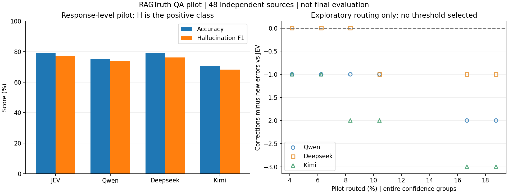

# RAGTruth QA 小规模真实 API 试跑

已完成 48 个独立问题、48 段回答 × 4 个核验模型；共 192 个终态结果。主口径 H=17、N=31，含 `implicit_true` 标注。

输入来自预留开发问题，未使用正式 validation/test；没有选定正式转交阈值。请求次数与失败尝试另见 [progress.json](progress.json)。

| 核验模型 | Accuracy | H Precision | H Recall | H F1 | 误报 / 漏报 | 无效输出 |
|---|---:|---:|---:|---:|---:|---:|
| jev-1.14.0 | 79.17% | 62.96% | 100.00% | 77.27% | 10 / 0 | 0 |
| qwen3.8-max | 75.00% | 58.62% | 100.00% | 73.91% | 12 / 0 | 0 |
| deepseek-v4.1-flash-1017 | 79.17% | 64.00% | 94.12% | 76.19% | 9 / 1 | 0 |
| kimi-k3.1-pro | 70.83% | 55.56% | 88.24% | 68.18% | 12 / 2 | 0 |

全部预测 N 的基线 accuracy 为 64.58%，H 类 F1 为 0。以上是开发试跑结果，不用于推断总体能力排名。

在 pilot 上扫描完整 confidence 组，转交率最多 20%。每个候选点只用于检查行为，不以此确定正式阈值：

- qwen3.8-max：6 个非零转交候选，净纠正范围 -2～-1 条。
- deepseek-v4.1-flash-1017：6 个非零转交候选，净纠正范围 -1～+0 条。
- kimi-k3.1-pro：6 个非零转交候选，净纠正范围 -3～-1 条。

排除 `implicit_true` 后，标签分布变为 H=13、N=35；保持原预测不变的敏感性分析：

| 核验模型 | Accuracy | H F1 |
|---|---:|---:|
| jev-1.14.0 | 70.83% | 65.00% |
| qwen3.8-max | 66.67% | 61.90% |
| deepseek-v4.1-flash-1017 | 70.83% | 63.16% |
| kimi-k3.1-pro | 66.67% | 60.00% |

该敏感性分析改变评分标签，未改变模型的严格证据一致性提示词，不能当作另一套提示词的性能结果。

完整指标、token、历史价格估算及请求耗时见 [summary.csv](summary.csv)，分组诊断见 [by_generator.csv](by_generator.csv)，所有探索性候选见 [exploratory_routing.csv](exploratory_routing.csv)。JEV 价格未知，未计算完整总费用。

下一步应先人工复核误报和漏报，再冻结提示词，在预留 validation 上进行按来源分组的阈值选择，最后评估独立 test。参见 [实验方案](../../docs/ragtruth.md)。
