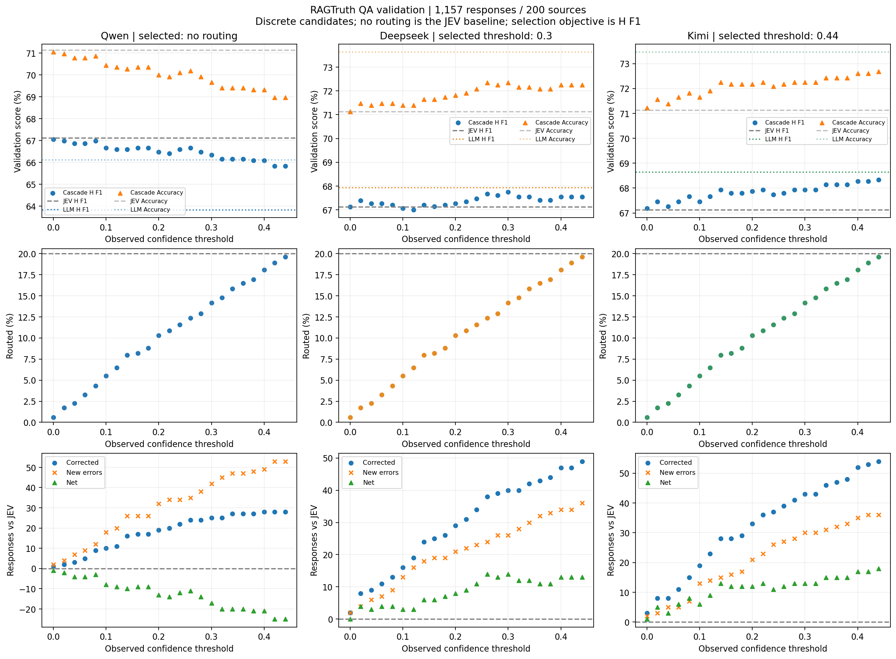
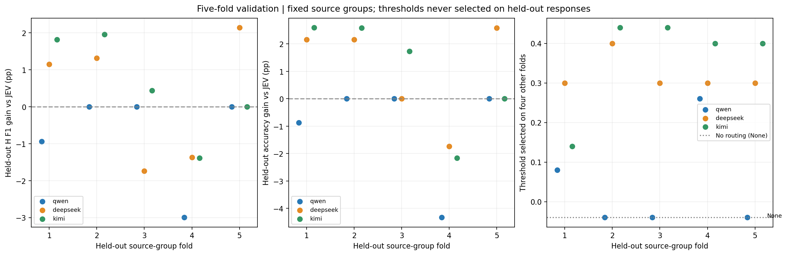

# RAGTruth QA 正式验证

正式 validation/test 已完成 **8,128 个终态结果**；另记录验证阶段 0 次、测试阶段 50 次非终态尝试。pilot 的 192 次请求未重复运行。收集并发与重试设置见各目录的 `collection_runs.json`，失败类型和无效终态见 `attempt_summary.json`。

[冻结协议](../../code/ragtruth_protocol.json) · [pilot 案例审阅](../../docs/ragtruth_pilot_review.md)。两阶段数据、配置与固定阈值通过哈希关联；代码可从逐条本地检查点独立复算结果。

正式 validation：200 个问题、1,157 段回答（H=367、N=790），四模型共 4,628 个终态结果。阈值以 H 类 F1 最大为目标；同分依次比较 accuracy、较少调用。完整 validation 上选择后的分数与五折折外分数分别报告。

JEV only：accuracy **71.13%**，H F1 **67.13%**。

| LLM | LLM only H F1 | 最终阈值 | 验证集转交 | 完整集级联 H F1 | 折外级联 H F1 | 完整集 / 折外 accuracy |
|---|---:|---|---:|---:|---:|---:|
| qwen | 63.84% | 不转交（null） | 0/1157（0.00%） | 67.13% | 66.34% | 71.13% / 70.10% |
| deepseek | 67.93% | 0.3 | 164/1157（14.17%） | 67.74% | 67.47% | 72.34% / 72.17% |
| kimi | 68.65% | 0.44 | 227/1157（19.62%） | 68.34% | 67.73% | 72.69% / 72.08% |

[固定阈值](../../code/ragtruth_validation_results/selected_threshold.json) · [验证指标](../../code/ragtruth_validation_results/summary.csv) · [逐折结果](../../code/ragtruth_validation_results/cross_validation.csv)

**这张图怎么看（RAGTruth validation，1,157 段回答）：** 三列从左到右对应 Qwen、DeepSeek、Kimi。九个小图的横轴都是尝试的 confidence 阈值；一个点表示采用该阈值后的整体结果，不是一条回答。confidence 是离散值，所以没有拟合或连接这些散点。

| 位置 | 纵轴与图形的含义 | 读图重点 |
|---|---|---|
| 第一行 | 分数（%）。蓝色圆点是级联 H F1，橙色三角是级联 accuracy；灰色横虚线表示 JEV only，彩色横点线表示该 LLM only，两种指标分别在图例中标明 | 同一种指标要与自己的基线比较。选阈值主要看 H F1，不是挑最高的 accuracy 点 |
| 第二行 | 被转交回答占全部验证回答的比例（%）；横虚线是 20% 选择预算 | 在同一个阈值下，是否转交只由 JEV confidence 决定，所以三列的转交点位置相同 |
| 第三行 | 回答条数。蓝色圆点是纠正，橙色叉号是改错，绿色三角是净变化；零线表示正确总数没变化 | 纠正多于改错，accuracy 才提高；H F1 还取决于改动的是 H 还是 N，不能只凭净变化选 F1 最优阈值 |

每列标题标明最终选中的策略。`no routing` 表示完全不转交，不能把它当作横轴上的 0；阈值等于 0 时，仍会转交 confidence 恰好等于 0 的回答。上方表格是完整验证集选阈值后的分数，接下来还要看五折和独立 test。

**这张五折图怎么看：** 三幅图的横轴都是留出折编号 1～5；每折有 40 个独立问题、231～232 段回答。蓝、橙、绿分别表示 Qwen、DeepSeek、Kimi。为了避免点重叠，三个模型的点在同一折附近稍微左右错开，不代表小数编号的折。

- **左图纵轴：** 在该份留出题上，级联的 H F1 减去 JEV 的 H F1，单位是百分点。高于 0 表示这一折检出效果有改善，低于 0 表示下降。
- **中图纵轴：** 同一批留出题的 accuracy 差值，也是百分点。F1 与 accuracy 的变化不一定同方向，要分开读。
- **右图纵轴：** 从另外四折选出的 confidence 阈值。标为 None 的 −0.04 位置只用于摆放“不转交”的点，不是真实负阈值。

每个点都在自己没参与选阈值的那份题上评分。各折既有正收益也有负收益，说明收益会随问题来源变化；不能只挑表现最好的一折。表格中的折外 F1 是合并全部留出预测后重算的，不是把五个 F1 简单平均。

**为什么 JEV + Qwen 不转交？** Qwen 已预测全部验证样本，我们用缓存逐个比较允许的转交阈值，也把“不转交”作为候选。选择规则先看 H F1，再看 accuracy，最后优先少调用。

| Qwen 的验证策略 | 转交条数 | H F1 | 纠正 / 改错 |
|---|---:|---:|---:|
| 不转交 | 0 | 67.13% | 0 / 0 |
| 最好的非零转交方案：confidence ≤ 0 | 7 | 67.06% | 1 / 2 |

本轮 23 个符合 20% 预算的数值阈值，H F1 都低于不转交。因此选择 null，并在 test 保持这个决定。不是漏调 Qwen，也不是必须用满 20% 预算。
