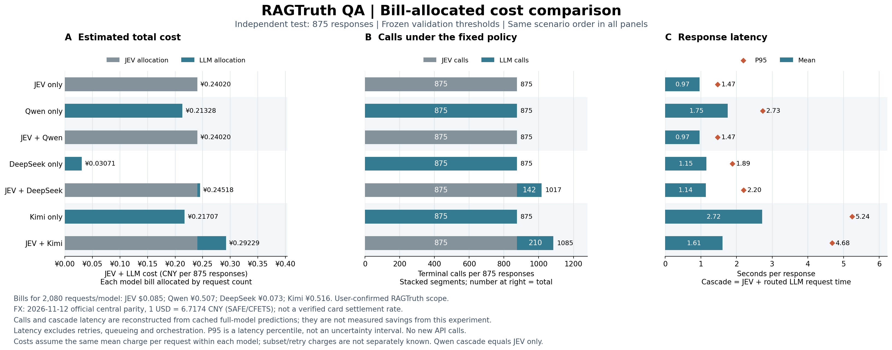

# RAGTruth 账单复核记录

README 主图展示历史单价假设下的美元估算。此记录单独保留此前提供的账单来源与复核结果，避免把价格情景分析当作实付节省。

**JEV、纯 LLM 和级联的开销对比（以用户确认的实际账单为依据）**

此前使用历史 token 单价得到的美元估算及“节省 97.06% / 43.93%～63.88% / 73.35%”不再作为本轮成本结论。用户随后提供了 2026-11-12 的人民币账单，并确认只覆盖 RAGTruth：每个模型均为 pilot 48 + validation 1,157 + test 875 = 2,080 条回答。截图总栏显示 ¥1.095，三个模型分项相加为 ¥1.096，相差 ¥0.001，可能来自显示舍入；以下使用各模型显示金额，不强行调平。

| 模型 | 全部 2,080 条的用户报告支出 | 换算人民币 |
|---|---:|---:|
| JEV | $0.085 | ¥0.57098 |
| Qwen only | ¥0.50700 | ¥0.50700 |
| DeepSeek only | ¥0.07300 | ¥0.07300 |
| Kimi only | ¥0.51600 | ¥0.51600 |

**统一币种：** 按实验与账单日期 2026-11-12 的官方人民币汇率中间价，`1 USD = 6.7174 CNY`。来源：[国家外汇管理局](https://www.safe.gov.cn/AppStructured/hlw/RMBQuery.do?COLLCC=546877760)、[中国外汇交易中心](https://www.chinamoney.com.cn/chinese/bkccpr/index.html?tab=2)。这是分析换算基准，不是已核实的信用卡结算汇率。

**如何分摊到 test：** 同一模型内采用统一的平均每次费用，`场景费用 = 该模型全部支出 / 2080 × 场景调用次数`。JEV 使用人民币换算后的支出。测试集 875 条只用 875 次的费用，不能把全程 2,080 次费用与测试集 875 次直接比较。

**账单与估算的区别：** 全程支出来自用户账单，test 和被转交子集的费用是平均分摊估算；截图没有逐请求实付金额，因此无法精确拆分 token 长度、缓存折扣或失败重试费用。本轮不另加重试费用，也不认定重试免费。不能把平均分摊当作固定每次报价。



**这张图怎么看：** 三幅图的每一行对应同一个方案；横轴均从 0 开始。

| 小图 | 横轴、柱子与标记 | 如何理解 |
|---|---|---|
| A，左侧：总费用估算 | 处理全部 875 条的费用（人民币）；灰色为 JEV，蓝色为 LLM，两段相加 | 越短越便宜。当前按实际账单分摊，已移除历史 DeepSeek 价格范围短线；JEV + Qwen 仍有 JEV 费用 |
| B，中间：调用次数 | 处理全部 875 条的终态请求数；灰色为 JEV，蓝色为 LLM，右侧数字为总数 | 级联先全部调用 JEV，再追加被转交的 LLM 请求；减少 LLM 次数不等于减少总请求数或总支出 |
| C，右侧：每条回答耗时 | 秒；蓝柱为平均值，橙色菱形为 P95，即约 95% 回答不超过的耗时 | 级联按 JEV 加上被转交 LLM 的耗时重建，不含重试、排队和编排；不是整轮实验运行时间 |

| 方案 | JEV 调用 | LLM 调用 | JEV 分摊（元） | LLM 分摊（元） | 总费用估算（元） |
|---|---:|---:|---:|---:|---:|
| JEV only | 875 | 0 | ¥0.24020 | ¥0.00000 | ¥0.24020 |
| Qwen only | 0 | 875 | ¥0.00000 | ¥0.21328 | ¥0.21328 |
| JEV + Qwen | 875 | 0 | ¥0.24020 | ¥0.00000 | ¥0.24020 |
| DeepSeek only | 0 | 875 | ¥0.00000 | ¥0.03071 | ¥0.03071 |
| JEV + DeepSeek | 875 | 142 | ¥0.24020 | ¥0.00498 | ¥0.24518 |
| Kimi only | 0 | 875 | ¥0.00000 | ¥0.21707 | ¥0.21707 |
| JEV + Kimi | 875 | 210 | ¥0.24020 | ¥0.05210 | ¥0.29229 |

**与对应纯 LLM 比较：** 正数表示级联更贵。

| 级联 | 总成本变化 | LLM 调用减少 |
|---|---:|---:|
| JEV + Qwen | +12.62% | 100.00% |
| JEV + DeepSeek | +698.39% | 83.77% |
| JEV + Kimi | +34.65% | 76.00% |

**本轮实际账单分摊不支持“级联降低总成本”。** JEV 单独处理这批数据的平均分摊费用，已经高于对应纯 LLM；再追加 LLM 请求会增加费用。减少 LLM 调用与降低总成本是两个不同结果。与纯 JEV 比，Qwen 级联成本相同，另外两种更高。

实验为了获得单模型基线而全量调用四个模型。上面的级联是按固定阈值重建的部署场景，不是本次实验已经实付的七份账单。原始 summary.csv 保留运行时的历史估算；新口径另存 [billed_cost_comparison.csv](../code/ragtruth_final_results/billed_cost_comparison.csv)，来源及假设见 [jev_billing.json](../code/ragtruth_final_results/jev_billing.json)、[llm_billing.json](../code/ragtruth_final_results/llm_billing.json)、[billed_cost_comparison_metadata.json](../code/ragtruth_final_results/billed_cost_comparison_metadata.json)。

从仓库根目录重画（仅读缓存，无新增 API 请求）：

```bash
python code/plot_ragtruth_costs.py --pricing billed
```
