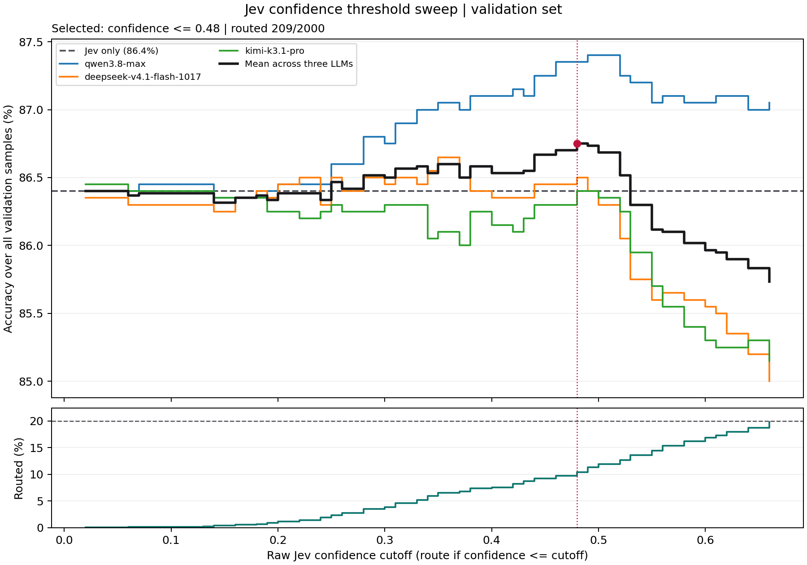
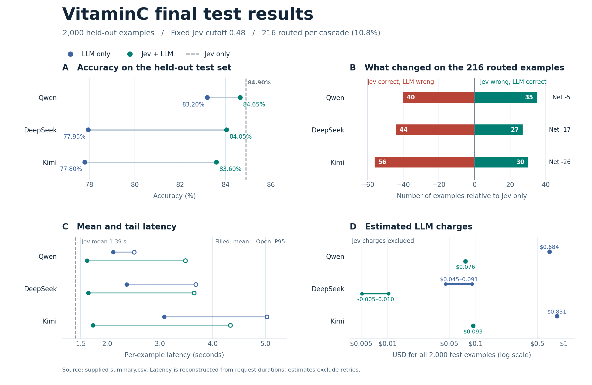

## 0 API key 与本地数据

API key 通过环境变量读取。将 `.env.example` 复制为 `.env`，填写自己的密钥，然后在仓库根目录执行：

```bash
set -a
source .env
set +a
```

`.env` 只保留在本地，不提交 Git。需要配置 `TYPESAFE_API_KEY` 和 `DASHSCOPE_API_KEY`。

原始 VitaminC JSONL 和实验切分 JSONL 不单独提交 Git，而是打包上传；逐条 API 日志和 SQLite 检查点保留在本地。GitHub 保存代码、数据压缩包、数据来源说明/许可证、配置、结果汇总和图表。

数据包已随仓库提供：[data/vitaminc.zip](data/vitaminc.zip)，包含原始 `vitaminc/` 和本次使用的 `vitaminc_splits/`（包括当前 2,000 条 test）。包内文件及 SHA256 记录在 `data/vitaminc_archive_manifest.json`。克隆仓库后，在仓库根目录还原：

```bash
unzip data/vitaminc.zip -d data
```

离线审计脚本还需要本地 `code/*_results/` 下的 SQLite 检查点；这些实验日志不包含在上述数据包中。

## 1 Data

vitaminc 文件夹下是我们最初始从数据集上下载下的 flagging 数据（带标签），初始作者将其分为 dev test train。

三个标签分别表示：S——支持，C——矛盾，I——证据不足

### 1.1 `split_vitaminc.py`

对原有的数据集dev和train部份做划分，划分为 4 份，其中每一份都包含 S C I 三个标签

| 实验子集 | 从哪里抽取 | 条数 | 用来做什么 |
|---|---|---:|---|
| `prompt_dev.jsonl` | 官方 `dev.jsonl` | 200 | 调整提示词、测试 API 能否正常返回结果 |
| `calibration.jsonl` | 官方 `dev.jsonl` | 2,000 | 用标准答案校准 Jev 的置信度 |
| `threshold_validation.jsonl` | 官方 `dev.jsonl` | 2,000 | 选择置信度低于多少时，把样本转交给 LLM |
| `test.jsonl` | 官方 `test.jsonl` | 5,000 | 固定提示词、校准参数和阈值后，做最终评估 |

附 log `split_report.json`

## 2 code

### 2.1 `test_jev.py`

测试 jev 接口。

- input：python test_jev.py ../data/vitaminc_splits/prompt_dev.jsonl
    - 后不加参数表示默认测试第一条数据，后加参数n表示测试第n条数据
- output：

```json
//python test_jev.py ../data/vitaminc_splits/prompt_dev.jsonl 6
样本编号: 6
Claim: Jamie XX produced Drake 's song Take Care that includes Rihanna 's vocals .
Evidence: It featured the single `` Far Nearer '' which was selected Best New Track by the influential Pitchfork Media music site and charted at # 128 in the UK singles chart.  produced the title track off Drake 's sophomore album , Take Care , which featured Rihanna.
{
  "model": "jev-1.14.0",
  "prediction": "S",
  "probabilities": {
    "S": 0.55,
    "C": 0.04,
    "I": 0.41
  },
  "confidence": 0.33,
  "gold": "S"
}
```

prediction 是 jev 的预测结果，probability 是 jev 得到的可能性分数，confidence 是 jev 对这次打分的自信程度，gold 是这条测试用例的 gt 值

在测试结果中可以大致看到当 confidence>0.5 的时候 gold 和 prediction一致，表示 jev 的预测在 confidence 高的时候基本正确，而在 confidence 低的时候基本预测出错，这个时候需要观察到并且转 llm 去判断；当然这个 confidence 的临界值还需要在后续实验中去具体决定

### 2.2 llm & tokens

使用 [阿里云百炼](https://bailian.console.aliyun.com/cn-beijing/model/market)，以量计费，预算200r（实际可能只需要50r），调用模型list：
- qwen3.8-max
- deepseek-v4.1-flash-1017
- kimi-k3.1-pro
- glm-5.3-prime：太贵了，最后我们不调了

百炼国际站（新加坡）的 API key 通过 `DASHSCOPE_API_KEY` 配置。实验中北京区 API key 无法调用当前国际站地址，改为新加坡区后可以调用；当时使用新加坡 VPN 节点。

### 2.3 `run_pilot.py`

- 从 `prompt_dev.jsonl` 中随机采样了 50 条数据（15 S, 15 C, 20 I）。
- 让 Jev 和四个 LLM 各跑这 50 条，一共进行 50 次 jev 调用和 200 次 llm 调用。
- 每条结果存下来，最少记录样本 ID、模型、预测标签、耗时和输入／输出 token。Jev 额外保存三类概率和 confidence。请求失败或返回无法解析的标签时，单独记为失败，避免算成 I。
- 看三项结果。 看每个模型的标签输出是否稳定、实际单条成本是多少，以及在 Jev 低置信度的样本里，纠正了几条、改错了几条。

一个测试，大致看一下预算需要多少。实验结果是 cut 掉 glm，一个模型占据了 80% 的开销。

实验结果在 `code/pilot_results`

### 2.4 `run_threshold.py`

选择一个适合的 threshold 作为 low confidence 的判断，在这个临界值将 jev 判断转交 llm

代码实现思路：
- jev 跑 2k 条数据（来自 `data/vitaminc_splits/threshold_validation.jsonl`），对所有 prediction 结果的 confidence 做排序，得到前 20% 低的 confidence 的数据（是因为我们以 20% 为成本上限，最多 20% 的数据转交 llm 继续判断）
- 在这一个 split 的数据集中我们得到了 396 条前 20% 低 confidence 的数据。注意，这里的 confidence 的数据是离散的，不连续且存在重复的数据，因此后续我们画出来的表也是生硬的。
- 对这些 396 条数据，跑遍 3 个 model，得到每一个 model 在每一个 threshold 下的预测 accuracy（指 jev+llm 的 accuracy）
- 绘表，每一个 model，和几个 model 的平均值



我们可以得到一些结论：

按 Jev 的置信度转交样本，可以用较少的 LLM 调用提高准确率，但收益取决于接手的模型和转交范围

- jev 是有效的。随着转交率提高至 0.48 以上，kimi 和 dpsk 都出现了大幅度 accuracy 降低，可见 kimi 和 dpsk 经常在 jev 判断正确的位置判断错误，可见 jev 是有效的。
- jev 中添加一定分量的 llm 辅助（这里特别说 qwen）可以提高判断的准确性，大概在 threshold 为 0.48 时，准确率最高。

那么接下来我们还要去说明，jev+llm 是可以在牺牲一点点 accuracy 上狠狠节省成本的。

### 2.5 `run_final_eval.py`

在跑这个代码前，我们认为 test 的数据集量太大了没有必要（原先 5k 条），于是我们修改了 `data/vitaminc_splits/test.jsonl`，改为 2k 条数据。具体操作是直接对这个 test 集进行了数据覆盖，没有修改 split 代码文件的代码内容。

```bash
python3 run_final_eval.py \
  --data ../data/vitaminc_splits/test.jsonl \
  --model qwen --plan
```

以上命令用来确定调用量，多少 samples，转交的 threshold，等等。去掉 `--plan` 运行，切换 `--model deepseek` `--model kimi` 运行另外两个 llm

这个阶段 threshold 固定为 0.48，合计 jev 转发了 216 条 qa。

合计我们跑了 2k 条 jev 调用，2k 条 qwen, kimi, dpsk 调用，result 信息在 `final_eval_results/summary.csv` 中，然后得到了以下的结论：能力 jev > qwen > dpsk > kimi。



| 方法 | 准确率 | Macro-F1 | 平均延迟 | P95 延迟 | LLM 费用估算 |
|---|---:|---:|---:|---:|---:|
| **Jev only** | **84.90%** | **82.19%** | **1.39 秒** | **1.49 秒** | — |
| Qwen only | 83.20% | 80.86% | 2.12 秒 | 2.51 秒 | $0.684 |
| **Jev + Qwen** | **84.65%** | **82.05%** | 1.62 秒 | 3.48 秒 | $0.076 |
| DeepSeek only | 77.95% | 74.52% | 2.37 秒 | 3.68 秒 | $0.045–0.091 |
| Jev + DeepSeek | 84.05% | 81.28% | 1.64 秒 | 3.65 秒 | $0.005–0.010 |
| Kimi only | 77.80% | 75.94% | 3.08 秒 | 5.02 秒 | $0.831 |
| Jev + Kimi | 83.60% | 81.09% | 1.74 秒 | 4.33 秒 | $0.093 |

结论：在这次 VitaminC 测试中，低 confidence 转交改善了纯 llm 的准确率和平均延迟，并大幅减少了 llm 调用，但没有观察到它进一步提高 jev 的accuracy

**但是这个结论是与之前跑 threshold 时候的结论相反的。**

<u>最明确的问题是验证集的页面分布严重偏斜；没有发现评分算错或两阶段请求配置不一致。</u>

（PS. 这个详细报告我们让 codex 仔细检查并写在了 `code/audit_results` 文件夹下）

我们重新检查了数据集，发现了一个比较明显的数据分布问题：验证集 2k 条中，有 1424 条来自同一个页面（意大利疫情），占 71.2%；Qwen 在阈值 0.48 下净纠正的 19 条中，18 条来自这个页面，其他页面合计只增加 1 条。这是验证收益缺乏代表性的直接证据。

测试集则分布在 316 个页面上。标签比例基本一致，也未发现四个实验子集之间的页面或样本重叠。同时我们仔细检查了一下个别数据集，存在原标签需要人工复核的案例。例如证据“销量超过 1,400 万”，不能严格推出 claim“少于 1,600 万”，但 gold 标为 S。类似疑点同时可能有利于不同模型，目前不能据此判断整体错标率。

低置信度样本中，验证集上 Qwen 比 JEV 准；测试集上 JEV 是 56.48%，Qwen 是 54.17%。JEV 低置信度意味着样本困难，并不保证 LLM 更擅长这些样本。

测试集上 JEV 比 Qwen 单模型高 1.70 个百分点；但级联比 JEV 低 0.25 个百分点，按页面 bootstrap 的 95% 区间为 −1.16～+0.57 个百分点，不足以认定级联稳定变差。
