# JEV + LLM：实验流程、结果与读图说明

我们研究一个问题：**先让 JEV 判断，遇到它不太有把握的样本，再交给另一个 LLM 判断，最终能否更准确，或者少调用一些 LLM？** 文中“转交”改变的是核验标签，不会自动改写原回答。

已经完成三轮实验，阅读时要分开看：

| 实验 | 核验什么 | 验证 / 测试规模 | 用什么指标选阈值 | 当前结论 |
|---|---|---|---|---|
| VitaminC v1（第 2 节） | 陈述与证据是否一致，S/C/I 三分类 | 各 2,000 条 | 三个级联 accuracy 的平均值 | 验证集有小幅收益，测试未复现；后来发现验证集过于集中在一个页面 |
| VitaminC v2（第 3 节） | 同一类任务，重新分散页面采样 | 各 2,000 条 | 每个级联单独最大化 accuracy | 三个级联的测试准确率都未超过 JEV；DeepSeek 级联的差值区间支持负收益 |
| RAGTruth QA（第 4 节） | 已生成回答是否含上下文幻觉，H/N 二分类 | 验证 1,157 段，测试 875 段 | 每个级联单独最大化幻觉类 F1 | Qwen 选中不转交；DeepSeek、Kimi 级联也未表现出稳定提升 |

这些结果针对各自的数据和请求设置，不能用跨数据集分数高低给模型排一个通用名次。两套数据都直接提供证据；这里评估的是核验环节，尚未评估我们自己的检索器。

**先认识图表中反复出现的词：**

| 图表用词 | 通俗解释 |
|---|---|
| JEV only / LLM only | 每条样本只采用这个模型的判断，作为比较基线 |
| Cascade / JEV + LLM（级联） | 先用 JEV；满足转交条件时采用 LLM 的判断，否则保留 JEV。无效 LLM 输出回退 JEV |
| Confidence | JEV 返回的把握程度分数；没有经过本项目校准，0.3 不表示有 30% 的概率答对 |
| Threshold / Cutoff（阈值） | 转交的分界值。`confidence <= threshold` 才转交；阈值越大，纳入的样本通常越多 |
| Routed / Routing rate（转交量 / 转交率） | 实际交给 LLM 的条数 / 占全部样本的比例。阈值 0.48 与转交率 48% 不是一回事 |
| Accuracy（准确率） | 全部样本里，预测标签与原标签一致的比例，越高越好 |
| H Precision（幻觉精确率） | 被模型判为“有幻觉”的回答中，多少确实被原数据标为 H；低时说明误报多 |
| H Recall（幻觉召回率） | 原数据标为 H 的回答中，模型找出了多少；低时说明漏报多 |
| H F1（幻觉类 F1） | 同时考虑 precision 和 recall 的分数，越高越好；只顾少漏报、却大量误报，也拿不到高分。它不是 accuracy |
| Macro-F1 | 先算每个标签各自的 F1，再让每个标签以同样的权重取平均；VitaminC 有三个标签，RAGTruth 有两个 |
| Corrected / Harmed / Net | “原来错、转交后对”的条数 / “原来对、转交后错”的条数 / 前者减后者。Net 为负表示转交后反而少答对了几条 |
| pp / Percentage points（百分点） | 两个百分比分数直接相减；从 68% 到 69% 是增加 1 个百分点 |
| Mean / P95 latency | 平均耗时 / 约 95% 样本不超过的耗时。P95 用来看较慢的那一部分请求，越小通常越快 |
| 95% interval（区间） | 按页面或问题分组反复重采样，估计分数差可能波动的范围。差值区间跨过 0，表示本轮证据不足以确定谁稳定更好，不代表已经证明一样好 |

**整个实验怎么走：** 准备并隔离数据 → 用 pilot 小规模检查接口和提示词 → 在 validation 上选阈值 → 固定策略 → 用独立 test 检验 → 统计误报、漏报、调用量和不确定性 → 生成图表。正式模型请求只做一次并缓存；扫描阈值、五折分析、bootstrap 和画图都用缓存重算，不需要为每个阈值重新调用模型。v1 的历史简化做法与 v2、RAGTruth 的完整流程分别在下文说明。

五折验证可以理解为把验证题按来源分成五份：每次用四份选阈值，在剩下一份检查效果，轮换五次。“折外分数”由这些未参与各自阈值选择的预测合并计算，通常比“在同一份验证集上挑出最高分”更能提醒我们过拟合的风险。测试集则留到最后，不能看完测试分数再回调阈值。

bootstrap 可以理解为在已有测试题里反复“重新抽一份试卷”。例如 RAGTruth 每次从 150 个问题中抽 150 次，允许重复抽到同一个问题，该问题的所有回答一起带入；各个模型用同一份抽题清单比较。重复 10,000 次后，看分数差在中间 95% 的抽样结果里落在哪里。这样估计的是现有题目来源变化带来的波动，不是重新调用模型 10,000 次，也不能消除原始标注可能存在的问题。

## 0 API key 与本地数据

API key 通过环境变量读取。将 `.env.example` 复制为 `.env`，填写自己的密钥，然后在仓库根目录执行：

```bash
set -a
source .env
set +a
```

`.env` 只保留在本地，不提交 Git。需要配置 `TYPESAFE_API_KEY` 和 `DASHSCOPE_API_KEY`。

原始 VitaminC JSONL 和实验切分 JSONL 不单独提交 Git，而是打包上传；逐条 API 日志和 SQLite 检查点保留在本地。GitHub 保存代码、数据压缩包、数据来源说明/许可证、配置、结果汇总和图表。

数据包已随仓库提供：[data/vitaminc.zip](data/vitaminc.zip)，包含原始 `vitaminc/` 和本次使用的 `vitaminc_splits/`（包括当前 2,000 条 test）。包内文件及 SHA256 记录在 `data/vitaminc_archive_manifest.json`。克隆仓库后，在仓库根目录还原：

```bash
unzip data/vitaminc.zip -d data
```

离线审计脚本还需要本地 `code/*_results/` 下的 SQLite 检查点；这些实验日志不包含在上述数据包中。

两个数据集分别存放：VitaminC 原始数据在 `data/vitaminc/`，实验切分在 `data/vitaminc_splits/` 和 `data/vitaminc_splits_v2/`；RAGTruth 原始数据在 `data/ragtruth_raw/`，本项目整理的 QA 实验数据在 `data/ragtruth_qa/`。RAGTruth 不包含在上述 VitaminC 压缩包中，通过第 4 节的数据准备脚本下载、校验和恢复。

## 1 数据与 v1 划分

VitaminC 实验使用 fact verification 数据：仅根据给定 claim/evidence 判定标签，不包含检索或生成环节。官方数据分为 train/dev/test；本项目只从 dev/test 的 real 样本构建实验集，没有使用 train 训练模型。后续 RAGTruth QA 实验见第 4 节，用于评估真实生成回答的幻觉检测。

一条 VitaminC 样本的核心是 `claim + evidence + label`：`claim` 是待核验的陈述，`evidence` 是用于核验的证据文本。它不是普通的“问题 Q + 答案 A”；claim 通常是较短的陈述，evidence 也不要求恰好只有一句话。模型的任务是判断二者的关系，而不是回答问题或生成新答案。

三个标签分别表示：**S——证据支持陈述，C——证据与陈述矛盾，I——证据不足以判断**。原始标签是整条 claim/evidence 对的关系，不提供 RAGTruth 那样的回答内幻觉片段位置。数据还保留 page、case_id、unique_id 等元数据，用于样本追踪和切分隔离。

### 1.1 `split_vitaminc.py`

v1 从官方 dev/test 切分为以下四份，每份包含 S/C/I。原算法通过 page、case、完整文本对及 ID 建立连通组，清理冲突标签和重复文本对，再做组隔离与标签分层采样。

| 实验子集 | 从哪里抽取 | 条数 | 用来做什么 |
|---|---|---:|---|
| `prompt_dev.jsonl` | 官方 `dev.jsonl` | 200 | 调整提示词、测试 API 能否正常返回结果 |
| `calibration.jsonl` | 官方 `dev.jsonl` | 2,000 | 预留校准集；v1/v2 均未拟合校准器 |
| `threshold_validation.jsonl` | 官方 `dev.jsonl` | 2,000 | 选择置信度低于多少时，把样本转交给 LLM |
| `test.jsonl` | 官方 `test.jsonl` | 实际 2,000（原抽取 5,000） | 固定提示词与阈值后做最终评估 |

v1 的 `split_report.json` 保存了最初 5,000 条 test 的划分记录，后来缩减为 2,000 条，旧报告未同步；该历史问题保留在审计记录中。v2 的数量和哈希由脚本生成。

## 2 v1 实验记录（已完成）

### 2.1 `test_jev.py`

测试 jev 接口。

- input：python test_jev.py ../data/vitaminc_splits/prompt_dev.jsonl
    - 后不加参数表示默认测试第一条数据，后加参数n表示测试第n条数据
- output：

```json
//python test_jev.py ../data/vitaminc_splits/prompt_dev.jsonl 6
样本编号: 6
Claim: Jamie XX produced Drake 's song Take Care that includes Rihanna 's vocals .
Evidence: It featured the single `` Far Nearer '' which was selected Best New Track by the influential Pitchfork Media music site and charted at # 128 in the UK singles chart.  produced the title track off Drake 's sophomore album , Take Care , which featured Rihanna.
{
  "model": "jev-1.14.0",
  "prediction": "S",
  "probabilities": {
    "S": 0.55,
    "C": 0.04,
    "I": 0.41
  },
  "confidence": 0.33,
  "gold": "S"
}
```

prediction 是 jev 的预测结果，probability 是 jev 得到的可能性分数，confidence 是 jev 对这次打分的自信程度，gold 是这条测试用例的 gt 值

confidence 是 API 返回的原始分数，不是经本项目校准的正确率。高分与低分的实际表现需要分组验证；低置信度不保证交给 LLM 后更准确。

### 2.2 llm & tokens

v1 使用 [阿里云百炼](https://bailian.console.aliyun.com/cn-beijing/model/market)，当时预算为 200 元。下表及代码中的费用是保存的实验估算口径，不是当前价格承诺。调用模型：

- qwen3.8-max
- deepseek-v4.1-flash-1017
- kimi-k3.1-pro
- glm-5.3-prime：太贵了，最后我们不调了

百炼国际站（新加坡）的 API key 通过 `DASHSCOPE_API_KEY` 配置。实验中北京区 API key 无法调用当前国际站地址，改为新加坡区后可以调用；当时使用新加坡 VPN 节点。

### 2.3 `run_pilot.py`

- 从 `prompt_dev.jsonl` 中随机采样了 50 条数据（15 S, 15 C, 20 I）。
- 让 Jev 和四个 LLM 各跑这 50 条，一共进行 50 次 jev 调用和 200 次 llm 调用。
- 每条结果存下来，最少记录样本 ID、模型、预测标签、耗时和输入／输出 token。Jev 额外保存三类概率和 confidence。请求失败或返回无法解析的标签时，单独记为失败，避免算成 I。
- 看三项结果。 看每个模型的标签输出是否稳定、实际单条成本是多少，以及在 Jev 低置信度的样本里，纠正了几条、改错了几条。

这次小规模测试也用于估计后续预算。GLM 占四个 LLM 费用估算合计的约 84%，因此后续正式实验没有继续使用它。这里的费用不包含 JEV。

实验结果在 [首次 pilot 汇总表](code/pilot_results/summary.csv)。以下图表直接读取这张表及当时的配置记录，不重新调用 API。

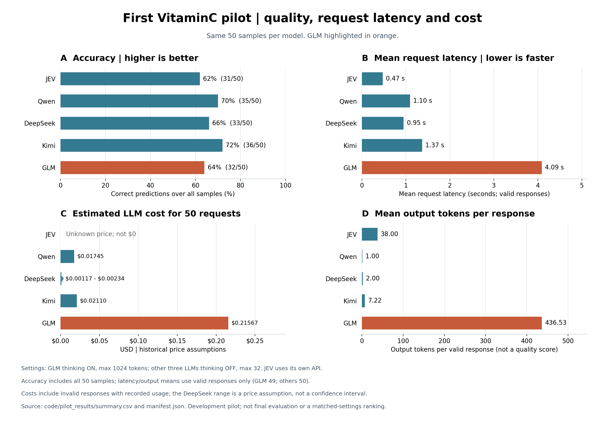

**这张图怎么看（VitaminC v1 pilot，同一批 50 条样本）：** 四幅图的纵轴都是五个核验模型；橙红色突出显示 GLM，其他模型为蓝绿色。所有横轴均从 0 开始。

| 小图 | 横轴是什么 | 如何读 |
|---|---|---|
| A，左上：准确率 | 全部 50 条中判断正确的比例（%） | 条形越长越准确；旁边同时标出答对条数。GLM 答对 32/50，为 64%，其 1 条无效输出也保留在分母里 |
| B，右上：平均耗时 | 一次有效请求的平均耗时（秒） | 越短越快。JEV 0.47 秒，Qwen 1.10 秒，DeepSeek 0.95 秒，Kimi 1.37 秒，GLM 4.09 秒；不是整轮实验的运行时间 |
| C，左下：费用 | 这批请求按历史价格计算的费用（美元） | GLM 约 $0.21567；DeepSeek 的短线表示 $0.00117～$0.00234 的价格假设范围，不是统计置信区间。JEV 单价未知，空白不能理解成免费 |
| D，右下：输出量 | 每次有效响应的平均输出 token 数 | GLM 为 436.53，其他三个 LLM 分别为 1.00、2.00、7.22；JEV 为 38.00。输出多有助于理解耗时和费用，但不代表判断更准确，不同模型的 token 也不是统一的字数单位 |

耗时与输出量沿用表中的统计口径：GLM 只统计 49 次有效响应，其他模型各 50 次；费用包含有 token 用量记录的无效响应。GLM 当时开启 thinking、输出上限 1,024 tokens，Qwen、DeepSeek、Kimi 则关闭 thinking、上限 32 tokens，JEV 使用独立接口。因此图中比较的是**当时各自配置下的表现**，不能把差异全部归因于模型本身，也不能将这 50 条开发试跑当作最终测试结论。

从仓库根目录重画：

```bash
python code/plot_pilot_v1.py
```

默认输出英文图，标题、坐标、数值注释和统计口径均为英文。也可加 `--chinese` 生成中文版本；没有可用中文字体时自动回退到英文。

### 2.4 v1 threshold 验证

这一阶段要选择转交的分界值：JEV 的 confidence 不高于这个值时，再采用 LLM 的判断。

代码实现思路：

- jev 跑 2k 条数据（来自 `data/vitaminc_splits/threshold_validation.jsonl`），对所有 prediction 结果的 confidence 做排序，得到前 20% 低的 confidence 的数据（是因为我们以 20% 为成本上限，最多 20% 的数据转交 llm 继续判断）
- 在这一个 split 的数据集中我们得到了 396 条前 20% 低 confidence 的数据。confidence 在本批返回值中是离散且存在重复的，同值样本整体转交；图中每个点表示一个实际出现的候选阈值，不连接相邻点。
- 对这些 396 条数据，跑遍 3 个 model，得到每一个 model 在每一个 threshold 下的预测 accuracy（指 jev+llm 的 accuracy）
- 绘表，每一个 model，和几个 model 的平均值


**这张图怎么看（v1 validation，2,000 条）：** 上下两幅图共用横轴，横轴是尝试的 confidence 阈值，不是某条样本的编号，也不是转交率。

- **上图纵轴：** 在全部 2,000 条验证样本上的级联准确率，单位是 %。蓝色圆点、橙色方点、绿色三角分别对应 JEV + Qwen、JEV + DeepSeek、JEV + Kimi；黑色叉号是三个级联准确率的平均值，不是让三个模型投票。每个点代表一个实际出现过的候选阈值，点越高，整体答对的比例越高。
- **下图纵轴：** 转交样本占 2,000 条的比例，单位是 %。例如阈值 0.48 对应 209 条，即 10.45%，需要从下图读出，不能把横轴数值当百分比。
- **参考线与选中点：** 上图灰色横虚线是 JEV only 的 86.40%；下图横虚线是验证阶段的 20% 转交上限。红色竖点线位于选定阈值 0.48，红圈标记该位置的三个级联平均准确率。

图中阈值增大时，转交率上升，但准确率并不会一直上升。它说明“多交给 LLM 一些”不必然更好。这里的点只描述这一份验证集，是否有效还要看后面的独立测试。

原阶梯图由 Git 历史 `02478e5` 中的 `code/run_threshold.py:158`（`write_plot()`）生成，使用 `accuracy.step()` 和 `routing.step()`。当前 `run_threshold.py` 已升级为 v2；此处的 v1 图使用独立脚本 [plot_threshold_v1.py](code/plot_threshold_v1.py)，从已保存的 `code/threshold_results/threshold_sweep.csv` 和 `selected_threshold.json` 重画为散点图，不调用模型 API，也不重新选择阈值。

```bash
python code/plot_threshold_v1.py
```

v1 在验证集上以三个级联 accuracy 的平均值选出原始 confidence 阈值 **0.48**，对应转交 **209/2000（10.45%）**，并非 48% 的转交率。该点 JEV only 为 86.40%，JEV + Qwen 为 87.35%，JEV + DeepSeek 为 86.50%，JEV + Kimi 为 86.40%。Qwen 自身的最高验证点是 0.49/0.50（87.40%）。

上图散点是 **JEV + LLM 的级联准确率**及其平均值，下图是转交率；横向虚线和纵向点线分别为基线／预算和选定阈值参考线。空阈值表示“不转交”，不作为 confidence = 0 的散点绘制；其准确率对应 JEV only 基线。LLM 各只跑了 396 条，未测完整验证集单模型基线。收益是否跨页面泛化、以及是否节省包含 JEV 在内的总费用，仍需要独立验证。

### 2.5 v1 final eval

在跑这个代码前，我们认为 test 的数据集量太大了没有必要（原先 5k 条），于是我们修改了 `data/vitaminc_splits/test.jsonl`，改为 2k 条数据。具体操作是直接对这个 test 集进行了数据覆盖，没有修改 split 代码文件的代码内容。

v1 当时使用写死的阈值运行。当前脚本已升级为 v2，运行命令见后文；v1 结果文件和图表原样保留。

这个阶段 threshold 固定为 0.48，合计 jev 转发了 216 条 claim/evidence 样本。

合计我们跑了 2k 条 jev 调用，2k 条 qwen, kimi, dpsk 调用，result 信息在 `final_eval_results/summary.csv` 中，在这批 VitaminC-real 样本及这套请求配置下，单模型 accuracy 依次为 JEV、Qwen、DeepSeek、Kimi；这个排序不代表通用模型能力。


**这张图怎么看（v1 test，2,000 条，固定阈值 0.48）：** 四个小图的纵轴都是 Qwen、DeepSeek、Kimi，表示三个不同的转交对象。蓝色代表 LLM only，绿色代表 JEV + LLM。

| 小图 | 横轴、点与线的含义 | 如何理解 |
|---|---|---|
| A，左上 | 横轴是全部测试样本的 accuracy（%）；竖虚线是 JEV only 的 84.90%。同一行的连线只连接 LLM only 与级联两个分数 | 越靠右越准确。绿色点比蓝色点靠右，却仍在 JEV 虚线左边：级联好于对应 LLM only，但没有超过 JEV |
| B，右上 | 横轴是条数；绿色条向右表示纠正，红色条向左表示改错。左侧负号只是用方向区分损失，并非存在负数条样本 | Qwen 纠正 35 条、改错 40 条，净变化是 −5。两边只统计正确性改变的样本，不能要求相加等于全部 216 条转交样本 |
| C，左下 | 横轴是每条样本的耗时（秒）；实心点是平均值，空心点是 P95，连线只把这两个统计量连接起来。竖虚线是 JEV 平均 1.39 秒 | 越靠左越快。级联平均耗时低于对应 LLM only，但少部分被转交样本要依次等待两个模型，P95 不一定更低 |
| D，右下 | 横轴是处理这 2,000 条样本的 LLM 部分费用估算（美元），采用对数刻度：相同距离表示相同倍数。DeepSeek 的短线是价格假设范围，不是统计置信区间 | 越靠左，估算的 LLM 费用越低。没有计入 JEV 费用，不能据此声称完整系统一定更便宜 |

| 方法 | 准确率 | Macro-F1 | 平均延迟 | P95 延迟 | LLM 费用估算 |
|---|---:|---:|---:|---:|---:|
| **Jev only** | **84.90%** | **82.19%** | **1.39 秒** | **1.49 秒** | — |
| Qwen only | 83.20% | 80.86% | 2.12 秒 | 2.51 秒 | $0.684 |
| **Jev + Qwen** | **84.65%** | **82.05%** | 1.62 秒 | 3.48 秒 | $0.076 |
| DeepSeek only | 77.95% | 74.52% | 2.37 秒 | 3.68 秒 | $0.045–0.091 |
| Jev + DeepSeek | 84.05% | 81.28% | 1.64 秒 | 3.65 秒 | $0.005–0.010 |
| Kimi only | 77.80% | 75.94% | 3.08 秒 | 5.02 秒 | $0.831 |
| Jev + Kimi | 83.60% | 81.09% | 1.74 秒 | 4.33 秒 | $0.093 |

结论：在这次 VitaminC 测试中，级联比对应的 LLM only 更准确、平均耗时更低，需要的 LLM 调用也少；但与 JEV only 比，三个级联都没有提高准确率。这里减少调用说的是按该策略部署的场景；本次为了比较单模型基线，仍然全量请求了三个 LLM。

### 2.6 v1 审计：验证收益没有在测试集复现

threshold 的级联曲线与最终单模型排名不是同一统计口径。真正需要解释的是，验证集的小幅级联收益未在 test 重现。

<u>最明确的问题是验证集的页面分布严重偏斜；没有发现评分算错或两阶段请求配置不一致。</u>

完整证据见 [v1 审计报告](code/audit_results/analysis_zh.md)。

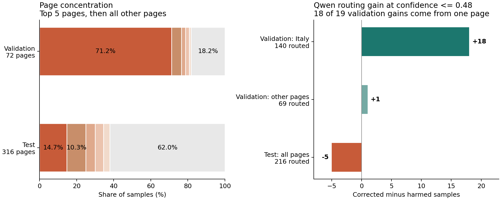

**这张审计图怎么看：**

- **左图横轴**是样本占比（%），**纵轴**是验证集和测试集，每一行合计 100%。前五个色块分别是该集合中样本最多的五个页面，灰色是其余页面；两行相同颜色表示相同排名，不保证是同一个页面。验证集第一个页面占 71.2%，说明题目来源非常集中；图旁的 72、316 是页面数，不是样本数。
- **右图横轴**是 Qwen 转交后的净纠正条数，**纵轴**分成验证集的意大利疫情页面、验证集的其他页面、整个测试集三组。向右为收益，向左为损失；标签中的 routed 是该组转交条数。验证集的 +19 几乎全来自单页的 +18，其他页面只有 +1；测试则是 −5。

它解释了为什么要做 v2：先让题目覆盖更多页面，再检查原来的收益能否重复出现。

我们重新检查了数据集，发现了一个比较明显的数据分布问题：验证集 2k 条中，有 1424 条来自同一个页面（意大利疫情），占 71.2%；Qwen 在阈值 0.48 下净纠正的 19 条中，18 条来自这个页面，其他页面合计只增加 1 条。这是验证收益缺乏代表性的直接证据。

测试集则分布在 316 个页面上。标签比例基本一致，也未发现四个实验子集之间的页面或样本重叠。同时我们仔细检查了一下个别数据集，存在原标签需要人工复核的案例。例如证据“销量超过 1,400 万”，不能严格推出 claim“少于 1,600 万”，但 gold 标为 S。类似疑点同时可能有利于不同模型，目前不能据此判断整体错标率。

低置信度样本中，验证集上 Qwen 比 JEV 准；测试集上 JEV 是 56.48%，Qwen 是 54.17%。JEV 低置信度意味着样本困难，并不保证 LLM 更擅长这些样本。

测试集上 JEV 比 Qwen 单模型高 1.70 个百分点；但级联比 JEV 低 0.25 个百分点，按页面 bootstrap 的 95% 区间为 −1.16～+0.57 个百分点，不足以认定级联稳定变差。


## 3 v2 研究问题与实施方式

研究问题：**在页面分布更分散的数据上，低置信度转交能否稳定改善准确率，或者以较少的 LLM 调用保持接近的表现？**

v2 将页面覆盖作为采样约束，评估对象与 v1 不同；两版分数分别报告，不把差值直接归因于模型或路由提升。全程使用原始 gold，不按模型表现筛样本或改标签。

### 3.1 数据、隔离与复现

- 原始清理规则与 v1 一致，仅使用 real 样本，移除冲突文本对及同标签重复。
- prompt_dev 200 条和 calibration 2,000 条按字节保留，其完整连通组不进入新 validation。calibration 仍只预留，路由使用 raw confidence。
- 新 validation 为 2,000 条，S/C/I = 996/575/429；新 test 为 2,000 条，S/C/I = 1002/575/423。配额沿用清理后官方来源池的比例。
- 新 test 排除旧 test 已评估的页面、case、文本对、ID 及关联的完整连通组。
- validation/test 每个页面最多 20 条。固定 seed `20261109`，在全体可用页面上用整数最大流分配标签配额和页面容量，再按 page/label 随机抽取行。容量不足时报错，不自动放宽规则。
- 输出连通组 ID、输入/输出哈希、标签数量、页面分布及隔离检查；原始样本和 v1 结果不被覆盖。

```bash
python data/split_vitaminc.py --mode v2 \
  --dev data/vitaminc/dev.jsonl --test data/vitaminc/test.jsonl \
  --previous data/vitaminc_splits --out data/vitaminc_splits_v2
```

重建切分前先解压第 0 节的 v1 数据包，以提供保留开发集和旧 test 排除清单。输出目录必须为空。使用 `--mode v1 --seed 20261015 --test-size 5000` 可在另一个新目录复现原始 v1 切分；原来手动缩减 test 的步骤不属于该算法。

### 3.2 完整验证基线、阈值与分组验证

四个模型各预测完整 validation 2,000 条。保持 v1 的模型名、提示词、thinking 和 token 上限；额外分组元数据不发送给模型。默认每模型 8 个并发请求，通过 `--workers` 可调整；本轮实际收集在初始 8 并发后改用 16 并发续跑，运行设置保存在结果目录的 `collection_runs.json`。请求并发会影响延迟，因此 v1/v2 延迟不可直接当作模型速度变化。

每个 LLM 独立选择阈值，以级联正确数最大为目标，同分优先少调用。规则是 `confidence <= threshold`，包括不转交候选（JSON 中为 null）；相同 confidence 的样本整体转交，选择集合上最多转交 20%。测试集及留出折如实报告实际转交率，不据此重新调阈值。

按 page/case 连通组固定划分五折，贪心平衡样本数与 S/C/I 数量；每次在四折选阈值、剩余一折评估。折外分数与完整验证集上选择后的表观分数分别保存。最终阈值用完整 validation 选定，写入包含模型配置、数据哈希和规则的结果文件。

### 3.3 独立 test、统计与失败处理

final eval 必须通过 `--thresholds` 输入完整 v2 阈值产物，校验模型、提示词与请求地址一致，并记录文件 SHA256。禁止根据 test 重新选阈值。

输出七种场景（JEV only、三个 LLM only、三个级联）的 accuracy、Macro-F1、混淆矩阵、各标签表现、纠正/改错、调用量、token、费用和延迟，并做 10,000 次按页面配对 bootstrap（seed `20261109`）。区间以当前样本和原标签为条件，不消除标签噪声或模型随机性。

SQLite 逐次保存请求；同一输出目录的数据/模型/阈值配置改变会拒绝续跑。网络、限流或 5xx 默认最多重试两次；明确的 HTTP 400 `data_inspection_failed` 属于服务商对单条内容的审查拒绝，保留原错误并记为终态，不改写输入、不反复重试。其他错误停止发起新请求并保存已在途结果。无效 LLM 标签或上述服务商拒绝在单模型中计错，在级联中回退 JEV；无效 JEV 返回停止实验。重跑相同命令跳过已有终态结果。

费用沿用 v1 保存的价格假设，JEV 单价未知时总费用保持空值。场景费用和延迟只累计终态请求；实际请求日志另记录中断/重试。若服务商拒绝未返回 token 用量，涉及该请求的费用估算保持空值，不假定其费用为零。级联延迟为 JEV 与被转交 LLM 的耗时之和，不含重试、排队与编排。

级联的调用量、费用和延迟由同一批预测离线重建，表示按固定策略部署时的场景估算。本轮为得到单模型基线而全量请求了所有模型，不能把低转交率当成本轮实验的实际请求节省。

### 3.4 从仓库根目录运行

批量脚本使用 Python 3.9+、标准库、NumPy 和 Matplotlib。单条 `test_jev.py` 另外使用 TypeSafe SDK，不是批量运行的依赖。

```bash
python -m pip install numpy matplotlib
set -a
source .env
set +a

# 只查看预算，不调用 API，也不写文件
python code/run_threshold.py --data data/vitaminc_splits_v2/threshold_validation.jsonl --plan

# 收集完整 validation，并生成阈值曲线、五折图和阈值产物
python code/run_threshold.py --data data/vitaminc_splits_v2/threshold_validation.jsonl

# 阈值产物生成后，检查 test 调用预算并运行
python code/run_final_eval.py --data data/vitaminc_splits_v2/test.jsonl \
  --thresholds code/threshold_results_v2/selected_threshold.json --plan
python code/run_final_eval.py --data data/vitaminc_splits_v2/test.jsonl \
  --thresholds code/threshold_results_v2/selected_threshold.json
```

两个脚本均支持 `--report-only` 从完整检查点离线重建图表、`--model jev|qwen|deepseek|kimi` 分批收集，以及 `--workers`、`--timeout`、`--retries`。单独收集部分模型只生成进度记录，全部模型完成后才生成最终报告。默认输出到独立的 v2 结果目录。

首次请求预算：validation 8,000 次、test 8,000 次，共 **16,000 次**，不含失败重试；不重跑 pilot。阈值扫描、分组验证及画图复用同一批预测，不增加 API 调用。

离线验收、打包和文档回填命令（均不调用模型 API）：

```bash
python -B -m unittest discover -s tests -v
python code/verify_v2.py
python data/package_vitaminc.py
python code/update_v2_readme.py
```

`verify_v2.py` 用独立实现检查数据、阈值选择、每个留出折和最终指标；未完成阶段明确显示 PENDING。`update_v2_readme.py` 仅更新下方标记的结果区块，从实际产物读取状态和分数。

### 3.5 v2 实际进度与结果

<!-- V2_RESULTS_START -->
数据切分已完成并通过复现与隔离检查。

| 子集 | 条数 | S / C / I | 页面数 | 最大页面条数 |
|---|---:|---|---:|---:|
| threshold_validation | 2000 | 996 / 575 / 429 | 277 | 20（1.0%） |
| test | 2000 | 1002 / 575 / 423 | 291 | 20（1.0%） |

[v2 划分报告](data/vitaminc_splits_v2/split_report.json)。

独立数据包：[vitaminc_v2.zip](data/vitaminc_v2.zip)，包含原始数据及 v2 四份切分；[SHA256 清单](data/vitaminc_v2_archive_manifest.json)。旧包继续保留。

```bash
unzip data/vitaminc_v2.zip -d data
```

- validation：已保存 8000/8000 个终态响应；收集完成，累计非终态失败尝试 10 次。
- test：已保存 8000/8000 个终态响应；收集完成，累计非终态失败尝试 11 次。

**validation 实际结果**（完整集最优值与折外分数分开）：

JEV only：80.45%。

| LLM | LLM only | 最终阈值 | 转交条数 | 完整集级联 accuracy | 折外级联 accuracy |
|---|---:|---:|---:|---:|---:|
| qwen3.8-max | 79.45% | 0.43 | 226 | 81.15% | 80.55% |
| deepseek-v4.1-flash-1017 | 74.30% | 0.3 | 91 | 80.65% | 80.15% |
| kimi-k3.1-pro | 75.45% | 0.09 | 6 | 80.55% | 80.45% |

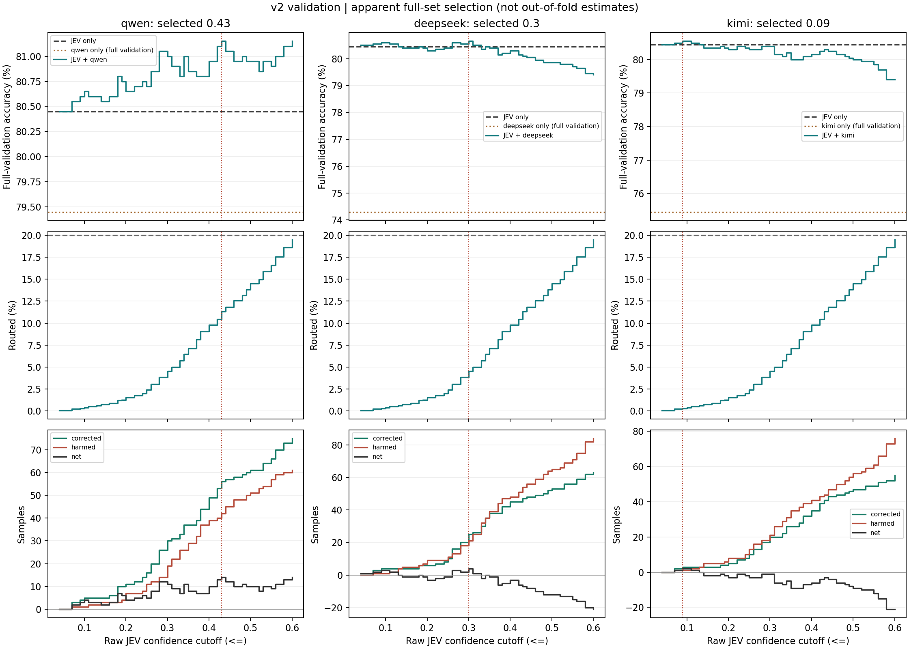

**这张图怎么看（VitaminC v2 validation，2,000 条）：** 三列从左到右是 Qwen、DeepSeek、Kimi；每列都有三幅图，共用横轴——JEV confidence 阈值。图中的阶梯表示跨过一个实际 confidence 值后，有一整组同分样本被纳入转交；这不是拟合曲线。

| 位置 | 纵轴与图形的含义 | 读图重点 |
|---|---|---|
| 第一行 | 全部 2,000 条验证样本的 accuracy（%）。绿色阶梯是级联，灰色横虚线是 JEV only，棕色横点线是该 LLM only | 绿色高于 JEV 线，表示在这份验证集上多答对了题；这里是用完整验证集选出来的分数，不能直接当作最终测试成绩 |
| 第二行 | 转交比例（%），横虚线是 20% 选择上限 | 横轴的 0.3 表示 confidence 阈值，纵轴才表示有多少比例被转交 |
| 第三行 | 样本条数。corrected 是纠正，harmed 是改错，net 是前者减后者；零线表示正确总数没有变化 | 净值大于 0 才是比 JEV 多答对。三个量不是三个不同的 accuracy |

红色竖点线和每列标题标明该模型最终选中的阈值；这三列可以选不同阈值。这里每个 LLM 都预测了完整验证集，因此 LLM only 横线是完整单模型基线。

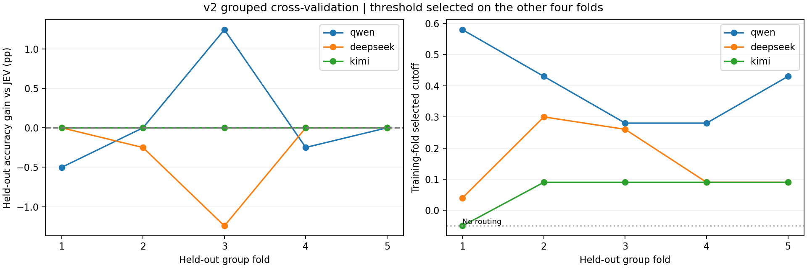

**这张五折图怎么看：** 两幅图的横轴都是留出折编号 1～5，即五份不同来源的验证题，不是时间顺序或训练轮数；颜色区分三个 LLM。点之间的连线只方便识别同一个模型，不表示拟合趋势。

- **左图纵轴：** 在该份留出题上，级联 accuracy 减去 JEV accuracy，单位是百分点。高于 0 表示这份题上有收益，低于 0 表示有损失。每个点使用的阈值都只从另外四份题中选出。
- **右图纵轴：** 那次从另外四折选出的 confidence 阈值。图中 −0.05 的位置专门表示“不转交”，不是合法的负 confidence。各折阈值不同，说明选择受抽到哪些来源影响。

例如 Qwen 在完整验证集选阈值后的 accuracy 是 81.15%，合并五份留出预测后的 accuracy 是 80.55%。后者是在每条题目没有参与自身阈值选择时得到的结果，不能与前者混为一谈。

[固定阈值产物](code/threshold_results_v2/selected_threshold.json)。

**独立 test 实际结果**：

| 方法 | Accuracy | Macro-F1 | 转交条数（比例） | 纠正 / 改错 | 对 JEV 的差值及 95% 区间（百分点） |
|---|---:|---:|---:|---|---|
| jev_only | 83.90% | 81.75% | — | — / — | +0.00 [+0.00, +0.00] |
| llm_only / qwen3.8-max | 81.85% | 80.16% | — | — / — | -2.05 [-3.57, -0.52] |
| cascade / qwen3.8-max | 83.75% | 81.79% | 185（9.25%） | 34 / 37 | -0.15 [-1.05, +0.75] |
| llm_only / deepseek-v4.1-flash-1017 | 77.40% | 74.48% | — | — / — | -6.50 [-8.17, -4.86] |
| cascade / deepseek-v4.1-flash-1017 | 83.00% | 80.80% | 80（4.00%） | 7 / 25 | -0.90 [-1.45, -0.36] |
| llm_only / kimi-k3.1-pro | 77.65% | 76.14% | — | — / — | -6.25 [-8.01, -4.50] |
| cascade / kimi-k3.1-pro | 83.75% | 81.62% | 4（0.20%） | 0 / 3 | -0.15 [-0.34, +0.00] |

服务商内容审查拒绝：qwen3.8-max：1 条。这些样本保留在分母中，单模型计错，若被转交则回退 JEV；本轮三个级联合计实际回退 0 条。未报告 token 用量的请求不假定免费，相应费用估算留空。

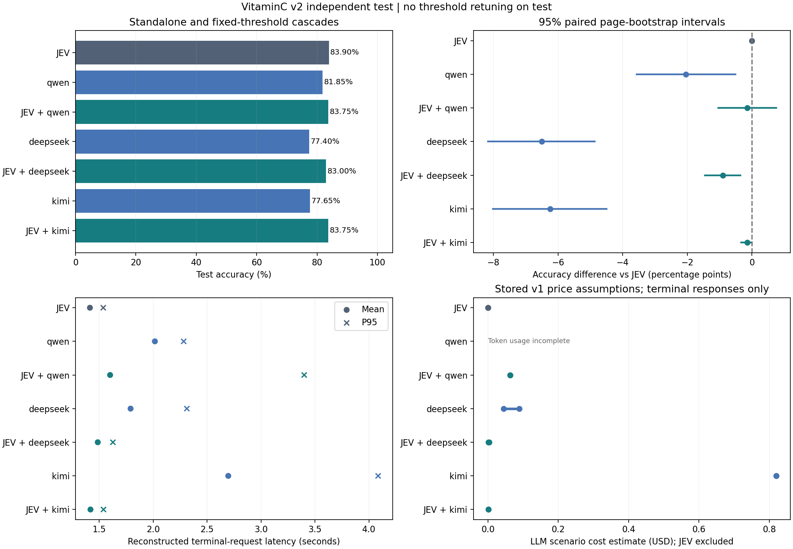

**这张图怎么看（VitaminC v2 独立 test，2,000 条）：** 四幅图的纵轴都是七种方案：JEV、三个 LLM only 和三个 JEV + LLM。灰色表示 JEV，蓝色表示 LLM only，绿色表示级联。

| 位置 | 横轴、点与线的含义 | 读图重点 |
|---|---|---|
| 左上 | test accuracy（%），横柱越长越准确 | 比较同一份测试题上的结果；这里的阈值已经固定 |
| 右上 | 与 JEV 的 accuracy 差值（百分点）；圆点是本次差值，横线是按页面配对 bootstrap 得到的 95% 区间，竖虚线是 0 | 整段在右边才支持正收益；整段在左边支持负收益；跨过 0 时不能确定稳定改善或下降 |
| 左下 | 根据终态请求重建的每条样本耗时（秒）；圆点是平均值，叉号是 P95 | 越靠左越快。级联把 JEV 耗时与被转交时的 LLM 耗时相加，不含排队、重试与编排 |
| 右下 | 按历史价格假设计算的 LLM 部分费用（美元）；短线是价格假设上下界，不是 95% 统计区间 | 不含 JEV 费用。Token usage incomplete 表示缺少 token 用量，不能当作零费用；JEV only 的 LLM 部分为零也不表示 JEV 免费 |

右上图中三个级联都没有落在明确的正收益区间；其中 DeepSeek 级联的整个区间在 0 左侧。少用 LLM 与提高准确率是两个不同问题，要分别看。

完整成本、延迟及调用量见 [summary.csv](code/final_eval_results_v2/summary.csv)，口径见 [报告元数据](code/final_eval_results_v2/report_metadata.json)。

- JEV + qwen3.8-max：区间包含零，尚不能判定稳定增益或损害。
- JEV + deepseek-v4.1-flash-1017：当前样本的区间支持负收益。
- JEV + kimi-k3.1-pro：区间包含零，尚不能判定稳定增益或损害。

本轮三个固定阈值级联的 test accuracy 均未超过 JEV only。分散页面后仍未观察到稳定的准确率提升，低 confidence 本身不足以确定 LLM 能否带来净纠正。

区间包含零不等于已经证明统计等价或非劣效；若要声称“接近的表现”，应在下一轮预先定义可接受的下降幅度。少量 LLM 调用是相对 LLM only 的场景比较；相对 JEV only，级联增加了调用。

上述判断仅适用于 v2 的页面采样、原标签和固定请求配置；不将 v1/v2 的分数差归因为模型能力变化。
<!-- V2_RESULTS_END -->

### 3.6 后续实验思路

- 在新的开发数据上检查各标签、页面和置信度区间的纠正与改错，重点研究“LLM 相对 JEV 的预期净收益”，而不仅是 JEV 自身是否低置信度。分析后的策略仍需在独立页面上验证。
- 若启用预留 calibration，先单独检验 JEV confidence 与正确率的关系；校准 JEV 的正确概率并不自动解决哪个模型更适合该样本的问题。
- 若研究目标是减少 LLM 调用并保持接近的准确率，先明确比较对象、可接受的下降幅度和调用预算，再用分组验证选择策略。JEV 价格明确前不声称整体费用更低。
- v2 test 已经使用，只作为本轮固定策略的最终评估。后续修改提示词、模型、校准或路由规则，应重新安排开发数据和未评估页面；不依据此 test 的表现回调阈值。

## 4 RAGTruth QA：真实生成回答的幻觉检测

已完成数据接入、pilot、正式阈值验证和独立测试。使用 [RAGTruth 官方数据](https://github.com/ParticleMedia/RAGTruth)中的问题、参考材料、已有模型回答和人工幻觉片段标注，研究 JEV 的核验能力以及低 confidence 转交的行为。正式 validation/test 结果见第 4.5 节。

### 4.1 官方数据是什么：raw 与 QA 的关系

RAGTruth 收集了模型基于给定材料生成的回答，并由人工标注回答中的幻觉片段。当前固定版本共有 2,965 份输入材料、17,790 段回答，覆盖三个官方任务：**QA（问答）、Summary（摘要）、Data2txt（结构化数据转文本）**。本轮仅使用 QA：989 个问题、5,934 段回答。

`data/ragtruth_raw/` 保存从固定上游版本下载的原始文件，核心数据在其 `dataset/` 子目录：

| 官方文件 | 保存的内容 | 如何关联 |
|---|---|---|
| `source_info.jsonl` | 输入材料、任务类型、原始生成提示词；QA 的 `source_info` 内包含 `question` 和 `passages` | 每份输入材料有一个 `source_id` |
| `response.jsonl` | 生成模型、回答、人工幻觉片段 `labels`、质量 `quality`、官方 `train/test` 标记 | 通过 `source_id` 对应输入材料；每段回答另有自己的 `id` |

同一份输入材料有六个生成模型各自给出的回答，因此“问题数”和“回答数”不同。这里的生成模型是原始数据的答案作者；本项目调用的 JEV、Qwen、DeepSeek、Kimi 是核验这些已有回答的模型。

`ragtruth_raw/` 中的 `README.md`、`LICENSE` 来自上游；`download_manifest.json` 是本项目生成的下载清单，记录固定提交、文件来源及 SHA256。`raw` 表示原始数据，`qa` 表示我们选取并整理后的问答子集，两者不是两个独立的数据集。`.jsonl` 文件每一行是一条独立的 JSON 记录；`split_report.json` 则是一个整体统计报告。

### 4.2 与 VitaminC 的区别

| 对比项 | 本项目的 VitaminC 实验 | 本项目的 RAGTruth QA 实验 |
|---|---|---|
| 单条输入 | 待核验陈述 `claim` + 证据 `evidence` | 问题 `question` + 多段参考材料 `evidence`（来自 `passages`）+ 已生成回答 `response` |
| 核验对象 | 一条陈述与证据的关系 | 整段回答中的事实是否得到参考材料支持 |
| 内容形态 | 通常是短陈述和证据文本，不是普通 Q/A 对 | 问题、较长上下文与可能包含多个事实的完整回答 |
| 原始人工标签 | 整条样本的支持／矛盾／证据不足 | 回答内幻觉片段的起止位置、文本、类型等 |
| 本项目预测标签 | S / C / I 三分类 | H / N 二分类，依据原始片段标注派生 |
| 切分隔离单位 | page、case、文本对、ID 形成的连通组 | `source_id`，同一问题和材料对应的多个回答一起分组 |
| 主要研究问题 | 低 confidence 转交能否改善事实核验 | 低 confidence 转交能否改善真实生成回答的幻觉检测 |

两者都使用已经给定的证据。RAGTruth 的输入与回答来自 RAG 场景，但本轮没有运行自己的检索器，也没有重新生成回答；因此它能评估核验环节，不能单独证明我们自己的检索系统有效。两套任务的标签、样本和难度不同，不直接比较其分数或沿用阈值。

### 4.3 QA 目录的文件划分及用途

`data/ragtruth_qa/` 由 [prepare_ragtruth.py](data/prepare_ragtruth.py) 生成：选取官方 QA 数据，将输入材料与回答按 `source_id` 合并，再按实验用途划分。**官方提供 train/test；prompt_dev、pilot、validation、train_reserved 是我们新增的实验划分，不是官方的幻觉类型分类。**

| 文件 | 数据来源 | 当前规模 | 实验用途 |
|---|---|---:|---|
| `prompt_dev.jsonl` | 官方 train | 48 个问题，277 段回答 | 检查样例、开发提示词和判断规则 |
| `pilot.jsonl` | prompt_dev 的子集，每个问题抽取一段回答 | 48 个问题，48 段回答 | 小规模真实 API 试跑，检查接入和标签处理 |
| `validation.jsonl` | 官方 train 中另外划分 | 200 个问题，1,157 段回答 | 正式选择阈值、进行五折验证 |
| `test.jsonl` | 官方 test 中符合质量条件的全部 QA 回答 | 150 个问题，875 段回答 | 提示词与阈值固定后的独立评估 |
| `train_reserved.jsonl` | 剩余符合条件的官方 train QA 回答 | 591 个问题，3,458 段回答 | 预留；当前未用于训练或评估 |
| `excluded_quality.jsonl` | 官方 QA 中质量标记不符合条件的回答 | 167 段回答 | 保留过滤原因，便于审计 |
| `split_report.json` | 本项目生成 | 统计与校验信息 | 记录来源哈希、seed、数量、标签分布和重叠检查 |

切分采用固定 seed `20261112`，按问题 `source_id` 分组；同一问题及参考材料对应的多个回答不拆到不同集合。prompt_dev、validation、test、train_reserved 之间没有问题重叠，规范化后的问题和完整参考材料也通过无重复检查。**pilot 是 prompt_dev 的子集，不能把两者的条数相加当成独立样本。** 抽取 pilot 时平衡六种原回答生成模型，不读取幻觉标签或核验模型的预测。

质量筛选沿用官方基线的 `quality=good` 条件：5,934 段 QA 回答保留 5,767 段，另外 143 段 `incorrect_refusal`（材料足够却错误拒答）和 24 段 `truncated`（意外截断）保存在 excluded_quality 中。`good` 不等于没有幻觉，只表示未被标记为上述质量异常；同一问题过滤后可能不足六段回答。

每条整理后的记录包含问题、材料、回答和原始标注，还保留 `official_split`（官方 train/test）与 `experiment_split`（本项目用途）。`annotations` 保留原始幻觉片段，`gold` 是据此派生的 H/N 标签。发送给核验模型的输入只有问题、材料和回答，不包含 gold 或人工片段标注。

### 4.4 上下文幻觉与 H/N 标签

这里的“上下文幻觉”指回答中的事实**与给定材料矛盾，或缺乏给定材料支持**。判断依据是当前材料，而不是仅凭外部常识判断一句话是否真实。例如，假设材料只说“博物馆周二至周日开放，周一闭馆”，回答声称“周一开放”属于矛盾；增加“门票为 50 元”则属于材料未支持的信息，即使现实中票价恰好为 50 元也一样。

一段回答可能同时含有矛盾和无依据的信息，因此本实验采用整段回答 **H / N 二分类**：H 表示至少有一个人工标注的幻觉片段；N 表示没有。主口径包含 `implicit_true`（虽然可能真实，但材料未提供支持），另报排除此类片段的敏感性分析。它与 VitaminC 的 S/C/I 分数、阈值不直接比较。

N 只表示原始人工标注中没有幻觉片段，不保证回答完整、有用或符合外部世界的事实。原始片段还区分明显／隐蔽的无依据内容与矛盾内容，但当前模型只预测整段回答的 H/N，不输出片段位置。各实验集合中都包含 H 和 N，并非按 H/N 分文件。

### 4.5 实验流程、实际结果与逐图说明

这一轮按下面的顺序完成；每个阶段各有用途，没有把 pilot、validation 和 test 混在一起选阈值。

1. **准备数据。** 下载固定版本，核对文件哈希，把问题、材料、回答和原始人工标注合并。只选 QA 和 quality=good 的回答，按问题隔离开发、验证和测试；不用模型预测挑题。
2. **用 pilot 检查接入。** 从 48 个开发问题中各抽一段回答，让四个模型真实判断，检查标签格式、长上下文处理、误报和漏报。审阅了 16 条至少有一个模型与 gold 不同的案例，保留原始标签及现有提示词。JEV、Qwen、DeepSeek、Kimi 都是核验已有回答，不重新回答原问题。
3. **固定请求方式，完整跑 validation。** 模型标识沿用前文配置，三个 LLM 都关闭 thinking，输出上限 32 tokens。四模型各判断 1,157 段回答，得到完整单模型基线。逐条缓存模型输出、JEV confidence、token 与耗时，避免后续扫描阈值时重复请求。
4. **先在验证集比较转交策略。** 对每个 LLM 分别尝试实际出现的 confidence 阈值，满足 `confidence <= threshold` 才转交；同分样本一起转交，选择集合上最多 20%。主要挑 H F1 最高的方案；同分再看 accuracy，仍同分就少调用。完全不转交也是合法候选，不要求用满预算。
5. **检查五折表现，再固定最终阈值。** 按问题分五折，每次在四折选阈值、在剩下一折评分；所有分析都复用缓存。最后才在完整 validation 上选出正式阈值，保存数据和请求配置的哈希，测试阶段不能临时更换。
6. **跑独立 test。** 四模型各判断 875 段回答，比较 JEV only、三个 LLM only 和三个固定阈值级联。即使某个级联选择不转交，也会保留该 LLM only 的完整结果用于比较。真实试验全量调用各模型；报告中的级联调用量表示按该策略部署会怎样。
7. **复算、看误差并画图。** 计算 accuracy、H precision/recall/F1、Macro-F1、混淆矩阵、纠正和改错；按问题整体重采样 10,000 次，比较相对 JEV 的分数差。再检查排除 implicit_true 的评分口径，输出表格、图表和结论。没有用 test 重新调阈值。

| 阶段 | 回答数 | 模型数 | 已收齐的模型结果 | 实际请求尝试 |
|---|---:|---:|---:|---:|
| pilot | 48 | 4 | 192 | 192 |
| validation | 1,157 | 4 | 4,628 | 4,628 |
| test | 875 | 4 | 3,500 | 3,550，含 50 次连接失败尝试 |

“已收齐的模型结果”表示每个样本、每个模型都有一个可以按预定规则评分的终态，包括单独记错的无效输出；不表示这些预测全部正确。重试、阈值扫描和 bootstrap 是不同事情：网络失败重试会增加请求，后两者只是本地计算。

**先看 pilot：接口与标签检查，不作为正式测试成绩。**

pilot 为 48 个开发问题、48 段回答，六种原回答生成模型各 8 段；H=17、N=31。四个核验模型已完成 192 次 pilot 请求，无失败或重试。

| pilot 核验模型 | Accuracy | H F1 | 误报 / 漏报 |
|---|---:|---:|---:|
| JEV | 79.17% | 77.27% | 10 / 0 |
| Qwen | 75.00% | 73.91% | 12 / 0 |
| DeepSeek | 79.17% | 76.19% | 9 / 1 |
| Kimi | 70.83% | 68.18% | 12 / 2 |

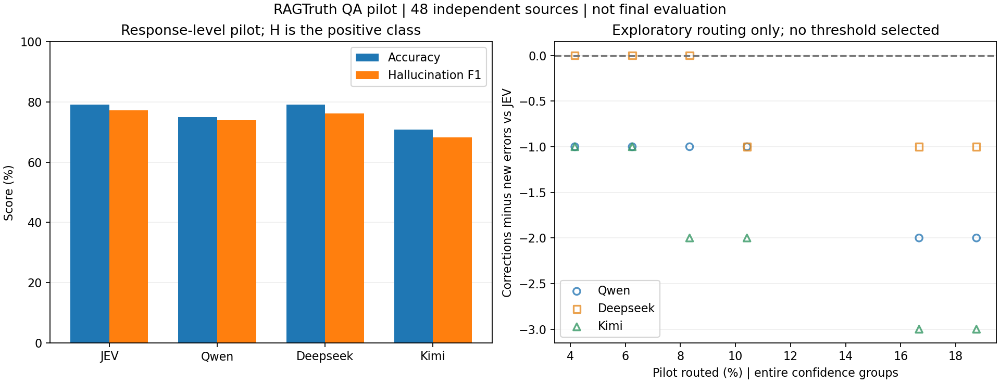

**这张 pilot 图怎么看：**

- **左图横轴**是四个核验模型，**纵轴**是分数（%）。蓝柱是 accuracy，橙柱是幻觉类 F1，越高越好。这是每个模型单独判断全部 48 段回答的结果，不是级联分数。
- **右图横轴**是转交比例（%），这里不是 confidence 阈值；**纵轴**是“纠正条数减去改错条数”，单位是条。圆圈、方框、三角分别表示 Qwen、DeepSeek、Kimi；每个点来自一个实际候选阈值。点落在零线下方，表示转交后少答对了题。重叠的点表示结果相同，没有拟合曲线。

pilot 的探索点没有出现正的净纠正，说明转交不保证有益。但只有 48 段回答，不能凭这个图宣布哪个模型通用能力更强，也不能直接从这里发布正式阈值。先确认接口和评分能工作，再使用独立的完整 validation 继续检验。

<!-- RAGTRUTH_RESULTS_START -->
正式 validation/test 已完成 **8,128 个终态结果**；另记录验证阶段 0 次、测试阶段 50 次非终态尝试。pilot 的 192 次请求未重复运行。收集并发与重试设置见各目录的 `collection_runs.json`，失败类型和无效终态见 `attempt_summary.json`。

[冻结协议](code/ragtruth_protocol.json) · [pilot 案例审阅](docs/ragtruth_pilot_review.md)。两阶段数据、配置与固定阈值通过哈希关联；代码可从逐条本地检查点独立复算结果。

正式 validation：200 个问题、1,157 段回答（H=367、N=790），四模型共 4,628 个终态结果。阈值以 H 类 F1 最大为目标；同分依次比较 accuracy、较少调用。完整 validation 上选择后的分数与五折折外分数分别报告。

JEV only：accuracy **71.13%**，H F1 **67.13%**。

| LLM | LLM only H F1 | 最终阈值 | 验证集转交 | 完整集级联 H F1 | 折外级联 H F1 | 完整集 / 折外 accuracy |
|---|---:|---|---:|---:|---:|---:|
| qwen | 63.84% | 不转交（null） | 0/1157（0.00%） | 67.13% | 66.34% | 71.13% / 70.10% |
| deepseek | 67.93% | 0.3 | 164/1157（14.17%） | 67.74% | 67.47% | 72.34% / 72.17% |
| kimi | 68.65% | 0.44 | 227/1157（19.62%） | 68.34% | 67.73% | 72.69% / 72.08% |

[固定阈值](code/ragtruth_validation_results/selected_threshold.json) · [验证指标](code/ragtruth_validation_results/summary.csv) · [逐折结果](code/ragtruth_validation_results/cross_validation.csv)

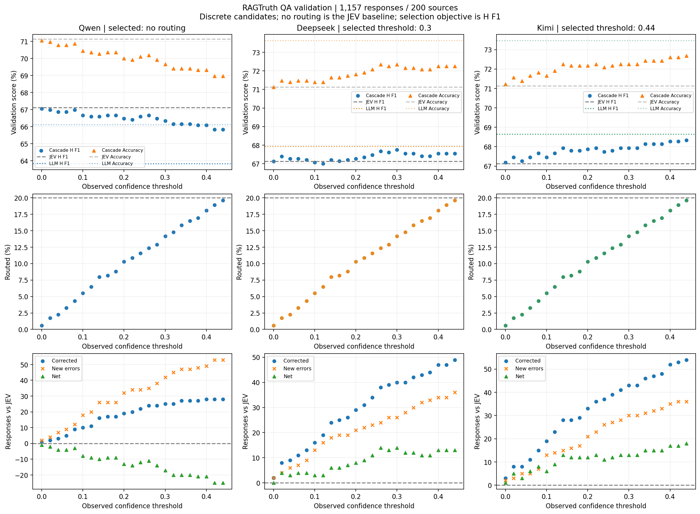

**这张图怎么看（RAGTruth validation，1,157 段回答）：** 三列从左到右对应 Qwen、DeepSeek、Kimi。九个小图的横轴都是尝试的 confidence 阈值；一个点表示采用该阈值后的整体结果，不是一条回答。confidence 是离散值，所以没有拟合或连接这些散点。

| 位置 | 纵轴与图形的含义 | 读图重点 |
|---|---|---|
| 第一行 | 分数（%）。蓝色圆点是级联 H F1，橙色三角是级联 accuracy；灰色横虚线表示 JEV only，彩色横点线表示该 LLM only，两种指标分别在图例中标明 | 同一种指标要与自己的基线比较。选阈值主要看 H F1，不是挑最高的 accuracy 点 |
| 第二行 | 被转交回答占全部验证回答的比例（%）；横虚线是 20% 选择预算 | 在同一个阈值下，是否转交只由 JEV confidence 决定，所以三列的转交点位置相同 |
| 第三行 | 回答条数。蓝色圆点是纠正，橙色叉号是改错，绿色三角是净变化；零线表示正确总数没变化 | 纠正多于改错，accuracy 才提高；H F1 还取决于改动的是 H 还是 N，不能只凭净变化选 F1 最优阈值 |

每列标题标明最终选中的策略。`no routing` 表示完全不转交，不能把它当作横轴上的 0；阈值等于 0 时，仍会转交 confidence 恰好等于 0 的回答。上方表格是完整验证集选阈值后的分数，接下来还要看五折和独立 test。

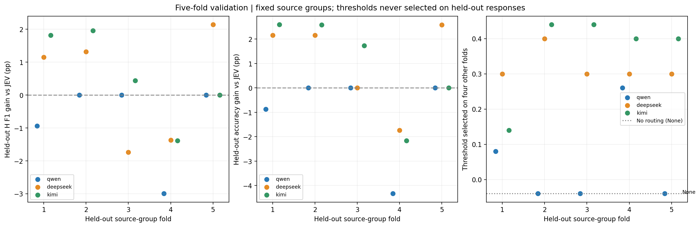

**这张五折图怎么看：** 三幅图的横轴都是留出折编号 1～5；每折有 40 个独立问题、231～232 段回答。蓝、橙、绿分别表示 Qwen、DeepSeek、Kimi。为了避免点重叠，三个模型的点在同一折附近稍微左右错开，不代表小数编号的折。

- **左图纵轴：** 在该份留出题上，级联的 H F1 减去 JEV 的 H F1，单位是百分点。高于 0 表示这一折检出效果有改善，低于 0 表示下降。
- **中图纵轴：** 同一批留出题的 accuracy 差值，也是百分点。F1 与 accuracy 的变化不一定同方向，要分开读。
- **右图纵轴：** 从另外四折选出的 confidence 阈值。标为 None 的 −0.04 位置只用于摆放“不转交”的点，不是真实负阈值。

每个点都在自己没参与选阈值的那份题上评分。各折既有正收益也有负收益，说明收益会随问题来源变化；不能只挑表现最好的一折。表格中的折外 F1 是合并全部留出预测后重算的，不是把五个 F1 简单平均。

**为什么 JEV + Qwen 不转交？** Qwen 已预测全部验证样本，我们用缓存逐个比较允许的转交阈值，也把“不转交”作为候选。选择规则先看 H F1，再看 accuracy，最后优先少调用。

| Qwen 的验证策略 | 转交条数 | H F1 | 纠正 / 改错 |
|---|---:|---:|---:|
| 不转交 | 0 | 67.13% | 0 / 0 |
| 最好的非零转交方案：confidence ≤ 0 | 7 | 67.06% | 1 / 2 |

本轮 23 个符合 20% 预算的数值阈值，H F1 都低于不转交。因此选择 null，并在 test 保持这个决定。不是漏调 Qwen，也不是必须用满 20% 预算。

独立 test：150 个问题、875 段回答（H=160、N=715），四模型共 3,500 个终态结果。使用完整 validation 固定的阈值，未按测试集重新选择。H 是幻觉阳性类；下列区间来自 10,000 次按 source_id 配对 bootstrap，单位为百分点。

| 方法 | Accuracy | Macro-F1 | H Precision | H Recall | H F1 | H F1 相对 JEV 差值 [95% 区间] |
|---|---:|---:|---:|---:|---:|---|
| jev_only | 68.00% | 64.38% | 36.24% | 98.75% | 53.02% | +0.00 [+0.00, +0.00] |
| llm_only/qwen | 61.14% | 58.50% | 31.78% | 98.12% | 48.01% | -5.01 [-6.89, -3.17] |
| llm_only/deepseek | 71.66% | 67.30% | 38.93% | 95.62% | 55.33% | +2.31 [-0.23, +4.88] |
| llm_only/kimi | 70.51% | 66.31% | 37.93% | 96.25% | 54.42% | +1.40 [-0.91, +3.71] |
| cascade/qwen | 68.00% | 64.38% | 36.24% | 98.75% | 53.02% | +0.00 [+0.00, +0.00] |
| cascade/deepseek | 67.20% | 63.58% | 35.54% | 97.50% | 52.09% | -0.93 [-2.27, +0.36] |
| cascade/kimi | 67.66% | 63.91% | 35.80% | 96.88% | 52.28% | -0.74 [-2.47, +0.94] |

全部预测 N 的 test accuracy 为 81.71%，H F1 为 0；因此不能仅凭 accuracy 评价幻觉检出效果。验证与测试的 H 比例不同，分数变化不能直接解释为方法变化。

单模型无效输出：jev_only：0 条；llm_only/qwen：0 条；llm_only/deepseek：1 条；llm_only/kimi：0 条。无效输出保留在评分分母中。

| 级联 | test 转交 | 纠正 / 改错 | 无效 LLM 回退 | Accuracy 相对 JEV 差值 [95% 区间] |
|---|---:|---:|---:|---|
| JEV + qwen | 0/875（0.00%） | 0 / 0 | 0 | +0.00 [+0.00, +0.00] |
| JEV + deepseek | 142/875（16.23%） | 18 / 25 | 1 | -0.80 [-2.48, +0.80] |
| JEV + kimi | 210/875（24.00%） | 35 / 38 | 0 | -0.34 [-2.30, +1.61] |

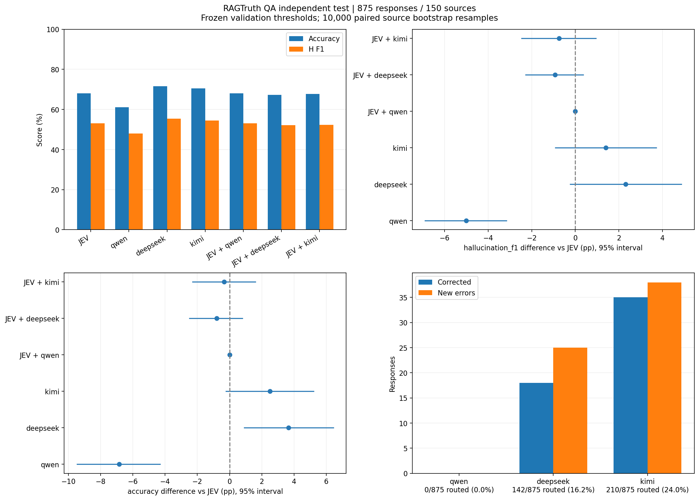

**这张图怎么看（RAGTruth 独立 test，875 段回答）：**

| 位置 | 横轴 | 纵轴、点与线的含义 | 读图重点 |
|---|---|---|---|
| 左上 | 七种方案，JEV、三个 LLM only 和三个级联 | 分数（%）；蓝柱是 accuracy，橙柱是 H F1 | 同色柱子之间比较，越高越好。高 accuracy 不一定代表能找出幻觉，所以同时看 H F1 |
| 右上 | H F1 相对 JEV 的差值（百分点） | 六种对比方案；圆点是本次差值，横线是 95% bootstrap 区间 | 竖虚线 0 表示与 JEV 一样；右侧为提高，左侧为降低；区间跨 0 时，本轮不足以确定稳定差异 |
| 左下 | accuracy 相对 JEV 的差值（百分点） | 与右上相同的六种方案、圆点和区间 | 比较的是准确率，不要把这里的区间当作 H F1 区间。横线是重采样区间，不是拟合线 |
| 右下 | 三个级联；标签同时列出实际转交条数和比例 | 发生变化的回答条数；蓝柱是纠正，橙柱是改错 | 蓝柱比橙柱高才是多答对题。两柱相加不一定等于转交总数，因为很多回答转交前后都对或都错 |

Qwen 级联的点与区间都落在 0，是因为验证阶段已经选中完全不转交，实际预测逐条等于 JEV；不是额外测试证明了两个不同模型等价。测试只应用固定策略，不在这张图上反过来挑新阈值。

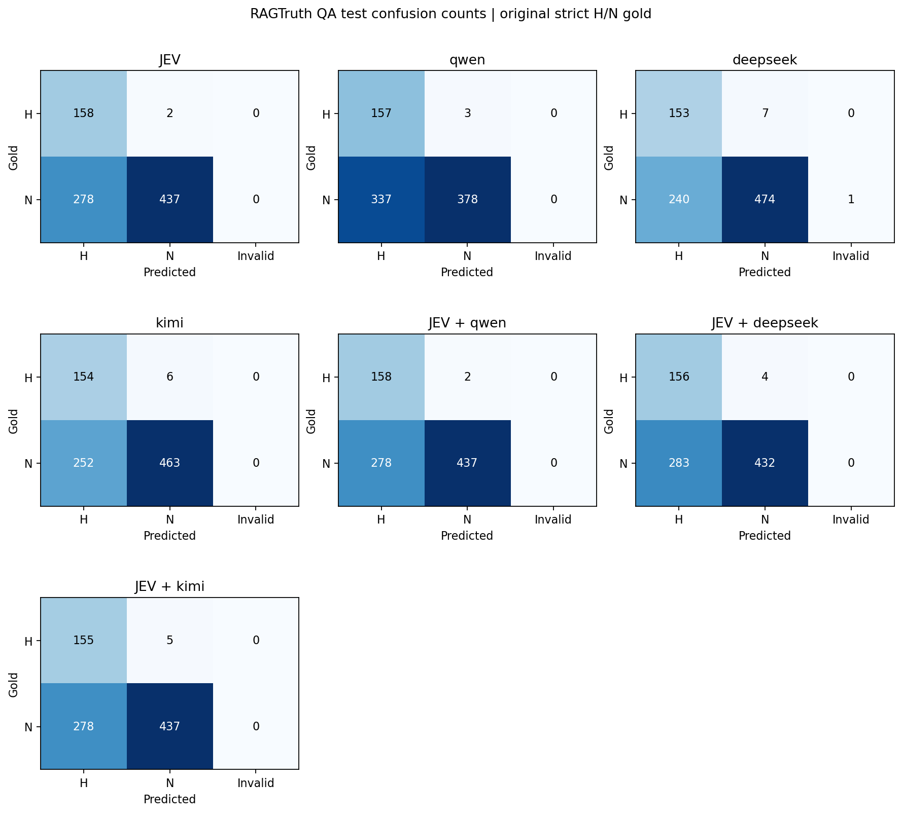

**这张混淆矩阵怎么看：** 七个小图分别对应七种方案，最后两个空位只是排版预留，不表示漏跑模型。每个小图的**横轴是模型预测**：H（有幻觉）、N（无幻觉）、Invalid（无效输出）；**纵轴是原数据标签**：H 或 N。每个格子的数字是回答条数，不是百分比。

| 格子位置 | 含义 |
|---|---|
| H 行、H 列 | 正确找出的幻觉 |
| H 行、N 列 | 有幻觉却没发现，即漏报 |
| N 行、H 列 | 原标注没有幻觉却被报为有，即误报 |
| N 行、N 列 | 正确判断为没有幻觉 |
| 任一行、Invalid 列 | 没有给出合法 H/N，单模型评分计错；级联按规则回退 JEV |

每幅图所有格子相加为 875；H 行合计 160，N 行合计 715。颜色越深表示该小图中数量越多，但不同小图分别缩放颜色，因此跨模型比较时要读数字，不能只比较深浅。理想情况是 H/H 与 N/N 格子大，误报、漏报和 Invalid 格子小。

[混淆矩阵图](code/ragtruth_final_results/confusion_matrices.png) · [完整指标、调用与成本](code/ragtruth_final_results/summary.csv) · [bootstrap](code/ragtruth_final_results/bootstrap.json) · [按原回答生成模型分组](code/ragtruth_final_results/by_generator.csv) · [排除 implicit_true 的敏感性评分](code/ragtruth_final_results/sensitivity_without_implicit_true.csv)

**JEV、纯 LLM 和级联的开销对比（历史单价假设，美元估算）**

本节比较 RAGTruth 独立 test 的同一批 875 条回答，固定验证阶段已选择的阈值。LLM 费用使用记录的实际 token 数乘以原实验保存的历史美元单价；JEV 使用用户提供的 $0.085 / 2,080 次平均分摊。这是一项价格情景分析，不是实际账单节省结论。

JEV 平均每次约 $0.00004087；875 次 test 请求约 $0.03576。所有级联都包含这 875 次 JEV。JEV 分摊不是已验证的固定每次报价；LLM 历史单价见 [report_metadata.json](code/ragtruth_final_results/report_metadata.json)，DeepSeek 保留两种单价假设。

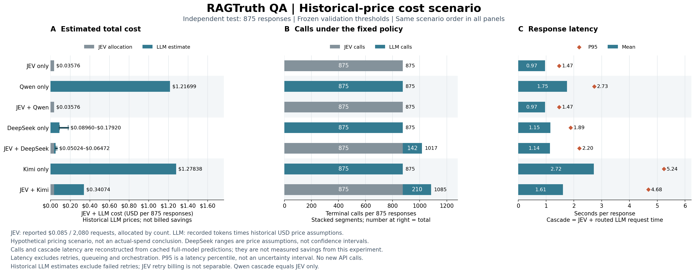

**这张图怎么看：** 三幅图的每一行对应同一个方案；横轴均从 0 开始。

| 小图 | 横轴、柱子与标记 | 如何理解 |
|---|---|---|
| A，左侧：总费用估算 | 处理全部 875 条的费用（美元）；灰色为 JEV 分摊，蓝色为 LLM 估算，两段相加 | 越短表示在这些价格假设下越便宜。DeepSeek 的横短线是价格假设范围，不是统计置信区间；不是实付费用 |
| B，中间：调用次数 | 处理全部 875 条的终态请求数；灰色为 JEV，蓝色为 LLM，右侧数字为总数 | 级联先全部调用 JEV，再追加被转交的 LLM 请求；减少 LLM 次数不一定减少总请求数 |
| C，右侧：每条回答耗时 | 秒；蓝柱为平均值，橙色菱形为 P95，即约 95% 回答不超过的耗时 | 级联按 JEV 加上被转交 LLM 的请求耗时重建，不含重试、排队和编排；不是整轮实验运行时间 |

| 方案 | JEV 调用 | LLM 调用 | JEV 分摊（美元） | LLM 估算（美元） | 总费用估算（美元） |
|---|---:|---:|---:|---:|---:|
| JEV only | 875 | 0 | $0.03576 | $0.00000 | $0.03576 |
| Qwen only | 0 | 875 | $0.00000 | $1.21699 | $1.21699 |
| JEV + Qwen | 875 | 0 | $0.03576 | $0.00000 | $0.03576 |
| DeepSeek only | 0 | 875 | $0.00000 | $0.08960–$0.17920 | $0.08960–$0.17920 |
| JEV + DeepSeek | 875 | 142 | $0.03576 | $0.01448–$0.02896 | $0.05024–$0.06472 |
| Kimi only | 0 | 875 | $0.00000 | $1.27838 | $1.27838 |
| JEV + Kimi | 875 | 210 | $0.03576 | $0.30498 | $0.34074 |

**相对对应纯 LLM，在相同历史价格假设下：**

| 级联 | 估算总费用降低 | LLM 调用减少 |
|---|---:|---:|
| JEV + Qwen | 97.06% | 100.00% |
| JEV + DeepSeek | 43.93%～63.88% | 83.77% |
| JEV + Kimi | 73.35% | 76.00% |

DeepSeek 降幅分别按低价与低价、高价与高价比较，不混用价格端点。Qwen 完全不转交，实际就是 JEV only；其较低估算费用不能当作非零转交策略有效的证据。

**本节结论仅在上述定价假设下成立。** 成本降低的比较对象是对应纯 LLM；与纯 JEV 比，额外转交仍增加费用。为获得单模型基线，本轮实际全量请求四个模型；这里是固定策略的部署场景重建，不是本次收集过程已经实现的费用节省。LLM 历史估算排除失败重试，JEV 报告总额中的重试计费无法单独拆分。

美元结果见 [cost_comparison.csv](code/ragtruth_final_results/cost_comparison.csv)，假设与来源哈希见 [cost_comparison_metadata.json](code/ragtruth_final_results/cost_comparison_metadata.json)。实际账单复核另存于 [复核记录](docs/ragtruth_billing_reconciliation.md)，其成本结论与本节价格情景不同，不将两者混用。

从仓库根目录重画（默认历史美元单价，无新增 API 请求）：

```bash
python code/plot_ragtruth_costs.py
```

**历史单价假设下，成本、准确率和延迟如何取舍？**

以上美元情景显示级联可以降低估算成本；效果与延迟仍使用原实验记录，必须相对同一个基线比较。不能用相对纯 JEV 的较小分数差，搭配相对纯 LLM 的费用下降，来构造同一个收益结论。

以下统一与**对应纯 LLM**比较，差值为级联减去纯 LLM；正的 accuracy 差值更好，负的延迟变化表示更快。

| 级联 | Accuracy：纯 LLM → 级联 | Accuracy 差值 [95% 区间]（百分点） | 平均延迟：纯 LLM → 级联（秒） | P95：纯 LLM → 级联（秒） |
|---|---:|---|---|---|
| cascade/qwen | 61.14% → 68.00% | +6.86 [+4.31, +9.46] | 1.752 → 0.967（-44.81%） | 2.732 → 1.471（-46.15%） |
| cascade/deepseek | 71.66% → 67.20% | -4.46 [-6.64, -2.28] | 1.153 → 1.138（-1.29%） | 1.887 → 2.196（+16.37%） |
| cascade/kimi | 70.51% → 67.66% | -2.86 [-4.56, -1.26] | 2.721 → 1.612（-40.77%） | 5.236 → 4.678（-10.66%） |

区间是本次补充分析：固定原预测与阈值，对 150 个 source_id 做 10,000 次配对 bootstrap（seed 20261112），直接比较每种级联与对应 LLM；不是把已有的两个相对 JEV 区间相减。区间未做多重比较校正。延迟仅报告记录重建值，未重新实跑级联或计算延迟置信区间。

- JEV + Qwen：不转交，实际就是 JEV；不能作为非零转交策略有效的证据。
- JEV + DeepSeek：accuracy 下降 4.46 个百分点，平均延迟只减少 1.29%，P95 增加 16.37%。
- JEV + Kimi：accuracy 下降 2.86 个百分点，平均延迟减少 40.77%，P95 减少 10.66%；在该历史价格情景下估算总成本降低 73.35%，体现了成本、速度与准确率的取舍。

DeepSeek、Kimi 相对纯 LLM 的 accuracy 差值区间均低于 0。H F1 也分别下降 3.25 和 2.14 个百分点，对应 95% 区间为 [-5.26, -1.27]、[-3.59, -0.76]。不能把这些差值说成没有下降；“下降不太多”需要预先定义业务可接受界限，本轮没有预设，不能事后宣称非劣效。

若改与纯 JEV 比，DeepSeek、Kimi 级联的 accuracy 分别只下降 0.80、0.34 个百分点，但平均延迟分别增加 17.66%、66.67%，总成本也增加；这同样不是全面改善。

**可报告的结论：** 在本次 RAGTruth QA 独立测试中，按历史 LLM 单价与 JEV 平均费用分摊估算，JEV + Kimi 相对纯 Kimi 的总成本降低 73.35%，重建的平均请求延迟降低 40.77%，P95 降低 10.66%；accuracy 从 70.51% 降至 67.66%，损失 2.86 个百分点。这表明在该定价情景下，可以用明确的准确率损失换取较低的估算成本与延迟。它不是实际账单省钱或准确率无损的证明，也不能外推成所有级联都能同时改善成本与延迟。

后续若研究“以较少损失换取成本下降”，应先固定同一个比较对象、可接受的 accuracy/H F1 下降幅度与延迟要求，再用开发数据选择满足这些约束的策略，并用新的独立测试验证。当前 test 不用于反向挑选支持结论的新阈值。

[直接配对比较](code/ragtruth_final_results/tradeoff_comparisons.csv) · [统计口径](code/ragtruth_final_results/tradeoff_metadata.json)。从仓库根目录复算：`python code/analyze_ragtruth_tradeoffs.py`（需要本地 predictions.jsonl；不调用 API）。

**如果不把 implicit_true 算作幻觉，结果会怎样？** 这项检查保留同一批预测和固定阈值，只改变评分标签：某段回答如果只有“材料没写、但可能真实”的片段，就从 H 改按 N 评分。test 的 H 从 160 段变为 134 段，回答总数仍为 875。

| 方案 | 主口径 H F1 | 排除 implicit_true 后的 H F1 |
|---|---:|---:|
| jev_only | 53.02% | 46.32% |
| llm_only/qwen | 48.01% | 41.72% |
| llm_only/deepseek | 55.33% | 48.20% |
| llm_only/kimi | 54.42% | 47.78% |
| cascade/qwen | 53.02% | 46.32% |
| cascade/deepseek | 52.09% | 45.38% |
| cascade/kimi | 52.28% | 45.50% |

这些分数评的是不同标签定义，不能把下降说成模型突然变差。本轮排除 implicit_true 后，过多报 H 的问题仍在；这不是重新训练或重新写提示词后得到的效果。

**本轮结论：**

- JEV + qwen：验证阶段选择不转交，实际策略与 JEV only 完全相同，差值及区间为零。
- JEV + deepseek：区间包含零，尚不能判定 H F1 稳定改善或下降。
- JEV + kimi：区间包含零，尚不能判定 H F1 稳定改善或下降。

**本轮未观察到固定阈值级联提高测试集 H 类 F1。** 单模型整体表现较好，也不保证在 JEV 的低置信度子集上更好。

JEV 在 test 上误报 278 条、漏报 2 条，H recall 为 98.75%、precision 为 36.24%。后续应在开发数据上复核误报与标注边界，并研究 LLM 相对 JEV 的净纠正能力。此 test 已用于最终评估，后续改策略需要新的独立评估数据。

测试集实际转交超过验证阶段的 20% 选择预算：kimi 为 24.00%。这反映固定 confidence 阈值在不同样本分布下的转交率变化，本轮未按 test 重新压低阈值。

无效终态详情见 [attempt_summary.json](code/ragtruth_final_results/attempt_summary.json)。

- deepseek-v4.1-flash-1017 / sample 12342：未返回合法 H/N；finish_reason=length，output_tokens=32。单模型计错，被转交时回退 JEV；未为该条改变配置或重新请求。

区间包含零不等于证明等价或非劣效。上述结论以当前 QA 样本和原人工标注为条件；模型误报可能涉及推断边界或标注覆盖疑点，不能仅凭模型一致判错就修改 gold。敏感性分析仅改变评分标签，不重调提示词或阈值。

实验为获得单模型基线而全量调用四个模型；级联调用量、费用和延迟由缓存离线重建，表示固定策略的部署场景。主图采用历史 LLM 美元单价和 JEV 平均请求费用分摊，总费用情景见 cost_comparison.csv；这是条件性的成本估算，不是实际支出结论。延迟按终态请求累计，不含重试、排队和编排。验证阶段 20% 是选择约束，独立测试如实报告实际转交率。
<!-- RAGTRUTH_RESULTS_END -->

试跑结果与散点图见 [RAGTruth pilot 报告](code/ragtruth_pilot_results/pilot_report.md)，完整指标见 [summary.csv](code/ragtruth_pilot_results/summary.csv)，数据统计见 [划分报告](data/ragtruth_qa/split_report.json)。这批 pilot 样本只用于开发检查，正式阈值与独立测试结果单独列在上方。

### 4.6 代码入口与复现

完整评分定义、正式实验协议及复现命令见 [docs/ragtruth.md](docs/ragtruth.md)。数据接入及 pilot 入口：

```bash
python data/prepare_ragtruth.py
python code/run_ragtruth_pilot.py --data data/ragtruth_qa/pilot.jsonl --plan
python code/run_ragtruth_pilot.py --data data/ragtruth_qa/pilot.jsonl
python code/verify_ragtruth.py
```

数据准备命令可在空目录或克隆后仅含划分报告的目录恢复数据，已有展开文件时使用新的 `--out`；模型调用前先按第 0 节载入环境变量。重跑 pilot 命令会复用本机现有检查点，修改数据或请求配置则拒绝混用。使用 `--report-only` 可离线重建图表与报告。检查点没有上传，其他机器上的收集命令会产生新的 API 请求。

正式阶段使用独立入口，所有命令从仓库根目录执行：

```bash
# 查看 validation 剩余预算；去掉 --plan 后开始真实请求
python code/run_ragtruth.py --stage validation --data data/ragtruth_qa/validation.jsonl --workers 16 --plan
python code/run_ragtruth.py --stage validation --data data/ragtruth_qa/validation.jsonl --workers 16
python code/verify_ragtruth_formal.py --stage validation

# test 必须使用已固定的 validation 阈值；同样可追加 --plan 查看预算
python code/run_ragtruth.py --stage test --data data/ragtruth_qa/test.jsonl \
  --thresholds code/ragtruth_validation_results/selected_threshold.json --workers 16

# 独立复算并从真实产物更新 README，不调用 API
python code/verify_ragtruth_formal.py
python code/update_ragtruth_readme.py
```

正式收集支持 `--model` 分模型运行；完整缓存生成后可追加 `--report-only` 离线重建结果。协议、数据和请求配置不匹配时拒绝混用缓存；test 还核对并记录阈值文件哈希。全部四模型完成前不会生成该阶段的最终报告。

## 5 从这几轮实验中学到了什么

**低 confidence 只能说明 JEV 对自己的判断不太有把握，不能说明另一个模型一定更擅长这些题。** VitaminC v1 曾在验证集看到收益，但审计发现收益主要来自同一个页面；v2 分散页面后，收益仍未在独立测试中稳定出现。RAGTruth 换成真实生成回答后，DeepSeek、Kimi 的验证收益也没有转化为测试集上的稳定 F1 改善。

因此要把三个问题分开：单模型谁表现好、在 JEV 不确定的题上谁更好、少调用 LLM 后是否仍能接受结果。本轮没有证明低 confidence 转交能稳定提升核验效果，也没有预先定义“允许下降多少”，所以还不能宣称已经证明与某个基线一样好。RAGTruth 主图采用历史 LLM 美元单价与 JEV 平均费用分摊。在这一价格情景下，Kimi 级联相对纯 Kimi 的估算总成本降低 73.35%，平均请求延迟降低 40.77%，accuracy 下降 2.86 个百分点，体现了可量化的成本、延迟和准确率取舍；这不是实付省钱或准确率无损的证明。此费用口径仅适用于本次 RAGTruth 分析，不外推到 VitaminC。

RAGTruth 中尤其要注意误报：JEV 找到了 160 段原标注幻觉回答中的 158 段，但同时把 278 段原标注为 N 的回答判成 H。“很少漏掉问题”和“说有问题时很可靠”是两回事。下一步应在尚未用于最终评估的开发材料上检查误报、推断边界和原标注覆盖，再研究哪些样本转交给哪个 LLM 才可能净纠正。已使用的 test 保留作为本轮结论，不边看它的成绩边改规则。

## 6 历史图留档与图表来源

上文已经展示本项目各阶段的实验结果图。v1 阈值还有一张较早的阶梯版留档，与第 2.4 节散点图使用同一批结果，不是额外一轮实验：

<details>
<summary>查看 v1 原始阈值阶梯图（历史留档）</summary>


横轴仍是 confidence 阈值；上图纵轴是全部 2,000 条验证样本的级联 accuracy（%），下图纵轴是转交率（%）。蓝、橙、绿线虽然在旧图例里仅写模型名，实际分别表示 JEV + Qwen、JEV + DeepSeek、JEV + Kimi；黑线是三个级联的平均准确率。灰色横虚线表示 JEV 基线／20% 预算，红色竖点线表示选定的 0.48。阶梯只表示跨过离散 confidence 后样本集合发生变化，没有拟合。当前主展示采用第 2.4 节的散点版。

</details>

| 图表 | 绘图代码或来源 |
|---|---|
| VitaminC v1 首次 pilot 对比 | [plot_pilot_v1.py](code/plot_pilot_v1.py)，读取原始 summary.csv 与 manifest.json |
| VitaminC v1 阈值散点 | [plot_threshold_v1.py](code/plot_threshold_v1.py)，读取保存的 threshold_sweep.csv |
| VitaminC v1 阈值阶梯留档 | Git 历史 `02478e5` 的 `code/run_threshold.py` 中 `write_plot()` |
| VitaminC v1 最终结果 | 保留的 [历史图](assets/eval_final_results.png)，图内注明来自 v1 summary.csv；当前 final eval 入口已升级为 v2 |
| VitaminC v1 审计 | [audit_experiments.py](code/audit_experiments.py) 中 `write_plot()` |
| VitaminC v2 阈值与五折 | [run_threshold.py](code/run_threshold.py) 中 `plot_reports()` |
| VitaminC v2 最终结果 | [run_final_eval.py](code/run_final_eval.py) 中 `plot_reports()` |
| RAGTruth pilot | [ragtruth_eval.py](code/ragtruth_eval.py) 中 `plot_report()` |
| RAGTruth 阈值、五折、最终结果与混淆矩阵 | [ragtruth_plots.py](code/ragtruth_plots.py) |
| RAGTruth 费用、调用次数与耗时 | [plot_ragtruth_costs.py](code/plot_ragtruth_costs.py)，默认读取独立 test 的 token 与历史美元单价，加上 JEV 平均费用分摊；--pricing billed 单独重建账单复核图 |

RAGTruth 级联与对应纯 LLM 的直接配对比较由 [analyze_ragtruth_tradeoffs.py](code/analyze_ragtruth_tradeoffs.py) 离线生成，见 `tradeoff_comparisons.csv` 与 `tradeoff_metadata.json`；没有改变原预测或阈值。

README 的 v2 和 RAGTruth 正式结果区块分别由 [update_v2_readme.py](code/update_v2_readme.py)、[update_ragtruth_readme.py](code/update_ragtruth_readme.py) 从真实产物更新；逐图说明也保存在生成脚本中，更新指标时会一并保留。
